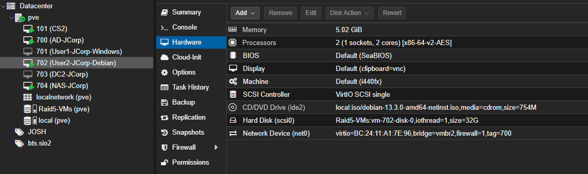

# Rapport de TP — Déploiement de ClamAV et de ClamUI sur un poste Debian

**Auteur :** Joshua Fernandes — SIO 2, option SISR
**Machine :** VM 702, `User2-JCorp-Debian`, Debian 13.3
**Date de réalisation :** à partir du 12 novembre 2026
**Dépôt d'infrastructure associé :** [JCorp-SISR](https://github.com/g0shtj0sh/JCorp-SISR)

---

## Sommaire

1. [Présentation de ClamAV](#1-présentation-de-clamav)
2. [Étape 1 — Installation du moteur et des signatures](#2-étape-1--installation-du-moteur-et-des-signatures)
3. [Étape 2 — Mise en service du démon](#3-étape-2--mise-en-service-du-démon)
4. [Étape 3 — Test de détection avec EICAR](#4-étape-3--test-de-détection-avec-eicar)
5. [Étape 4 — Protection en temps réel et quarantaine](#5-étape-4--protection-en-temps-réel-et-quarantaine)
6. [Étape 5 — Analyse planifiée](#6-étape-5--analyse-planifiée)
7. [Étape 6 — Interface graphique ClamUI](#7-étape-6--interface-graphique-clamui)
8. [Étape 7 — Recette](#8-étape-7--recette)
9. [Limites et conclusion](#9-limites-et-conclusion)

---

## 1. Présentation de ClamAV

ClamAV est un moteur antivirus open source principalement déployé sur les serveurs Linux et les NAS. Il ne cherche pas à deviner si un fichier est malveillant : il compare le contenu des fichiers à une **base de signatures virales**, c'est-à-dire un ensemble d'empreintes de logiciels malveillants connus, mise à jour régulièrement. Son efficacité dépend donc directement de la fraîcheur de cette base.

Il se décompose en plusieurs composants, qu'il faut distinguer pour comprendre la suite du rapport.

| Composant | Rôle |
| --- | --- |
| `clamscan` | Scanner autonome en ligne de commande, embarque son propre moteur |
| `clamd` (`clamav-daemon`) | Démon qui garde la base de signatures chargée en mémoire |
| `clamdscan` | Client léger qui interroge le démon `clamd` |
| `freshclam` | Service de mise à jour des bases de signatures |
| `clamonacc` | Analyse à l'accès (*On-Access*), c'est-à-dire en temps réel |

### Pourquoi deux outils de scan ?

`clamscan` et `clamdscan` font le même travail mais pas de la même façon, et le choix a des conséquences concrètes sur une machine aussi modeste que la VM 702.

| Critère | `clamscan` | `clamdscan` |
| --- | --- | --- |
| Démon requis | Non | Oui |
| Base de signatures | Rechargée à chaque exécution | Déjà chargée en permanence |
| Vitesse de démarrage | Lente, plusieurs secondes | Quasi instantanée |
| Mémoire | Plusieurs centaines de Mio à chaque lancement | Faible côté client, le démon porte la charge |
| Configuration | Options en ligne de commande | Hérite de `clamd.conf` |
| Accès aux fichiers | Lit directement les fichiers | Le démon tourne sous l'utilisateur `clamav`, d'où le besoin fréquent de `--fdpass` |

En clair : `clamscan` convient à une analyse ponctuelle ou planifiée la nuit, `clamdscan` convient à tout ce qui doit répondre vite, et la protection en temps réel impose le démon.

### Contrainte de dimensionnement relevée

Le démon `clamd` conserve l'intégralité de la base de signatures en mémoire, ce qui représente de l'ordre de **1 Gio de RAM**. La VM 702 avait été créée avec **2 Gio**, ce qui suffit à un poste bureautique sous GNOME mais laisse peu de marge une fois le démon chargé. La mémoire de la machine a donc été portée à **4,8 Gio** avant le début du TP, ce que confirme le relevé de l'état initial à l'étape 1. Cette décision est détaillée à l'étape 2.

---

## 2. Étape 1 — Installation du moteur et des signatures

### 2.1 Objectif

Installer le moteur ClamAV sur le poste et télécharger une base de signatures à jour, puis s'assurer que la mise à jour automatique est active.

### 2.2 État initial de la machine

Je relève l'état de départ avant toute modification, de façon à pouvoir justifier ensuite mes choix de dimensionnement.

```bash
sudo apt update
hostnamectl ; echo "---" ; free -h ; echo "---" ; df -h /
```

Les trois dépôts `trixie`, `trixie-security` et `trixie-updates` répondent. APT signale **70 paquets pouvant être mis à jour** : ces mises à jour ne sont pas appliquées dans le cadre de ce TP, afin de ne pas mélanger leurs effets avec ceux de l'installation de l'antivirus.

**Résultat observé :**

| Élément | Valeur relevée |
| --- | --- |
| Nom de machine | `User2-JCorp` |
| Système | Debian GNU/Linux 13 (trixie) |
| Noyau | `6.12.111+deb13-amd64`, architecture x86-64 |
| Virtualisation | KVM, machine `i440FX`, fournisseur QEMU |
| Mémoire totale | 4,8 Gio, dont **3,8 Gio disponibles** |
| Espace d'échange | 1,7 Gio, inutilisé |
| Disque racine | `/dev/sda1`, 30 Gio, 6,0 Gio utilisés, **23 Gio disponibles** (22 %) |

Ces deux derniers chiffres sont ceux qui comptent pour la suite : les bases de signatures occupent une centaine de mébioctets sur le disque, et le démon en chargera l'équivalent en mémoire. Avec 3,8 Gio de RAM disponible et 23 Gio d'espace libre, la machine est correctement dimensionnée pour accueillir ClamAV avec sa protection en temps réel.


### 2.3 Contrôle des prérequis réseau

Les bases de signatures pèsent une centaine de mébioctets et sont téléchargées depuis Internet. Un dépôt APT ou un serveur de mise à jour inaccessible ferait échouer les deux étapes suivantes, c'est pourquoi je contrôle la résolution de noms interne et externe ainsi que l'horloge avant de commencer.

```bash
getent hosts jcorp-dc01.ad.jcorp
getent ahostsv4 deb.debian.org
timedatectl
```

**Résultat attendu :** le contrôleur de domaine et un nom externe sont tous deux résolus, l'horloge indique `System clock synchronized: yes` et `NTP service: active`.

**Résultat observé :**

| Contrôle | Valeur relevée |
| --- | --- |
| Résolution interne | `jcorp-dc01.ad.jcorp` → `10.2.101.10` |
| Résolution externe | `deb.debian.org` → `199.232.82.132` (`debian.map.fastlydns.net`) |
| Horloge | `System clock synchronized: yes`, `NTP service: active` |

Les trois contrôles sont conformes. La résolution externe confirme que la correction des redirecteurs DNS sur `JCORP-DC01`, réalisée lors de la mise en place du socle, reste effective : le poste n'interroge que le DNS du domaine, et c'est le contrôleur qui relaie les demandes Internet.


### 2.4 Installation des paquets

```bash
sudo apt update
sudo apt install -y clamav clamav-daemon
```

Ces deux paquets installent le moteur de détection ainsi que le démon, et entraînent l'installation des dépendances `clamav-base`, `clamav-freshclam`, `clamdscan` et `libclamav12`. Le service de mise à jour `freshclam` est donc présent sans avoir à l'installer explicitement.

**Résultat observé :** six paquets installés, **15,3 Mo téléchargés** et **70,5 Mo d'espace disque occupés**. APT crée à cette occasion deux liens symboliques qui préparent le démarrage automatique du démon :

```
/etc/systemd/system/multi-user.target.wants/clamav-daemon.service
/etc/systemd/system/sockets.target.wants/clamav-daemon.socket
```

La sortie contient la ligne `id: 'clamav' : utilisateur inexistant` pendant le paramétrage de `clamav-base`. Ce message n'est pas une erreur : il apparaît parce que le script de configuration vérifie l'existence du compte de service **avant** de le créer. L'installation se poursuit normalement et le compte `clamav` est bien présent ensuite, comme le confirme le propriétaire des fichiers de signatures au contrôle 2.6.


Je relève ensuite la version exacte du moteur, qui sera reportée dans la recette :

```bash
clamscan --version ; dpkg -l | grep clamav
```

**Résultat observé :** `ClamAV 1.4.3/28181/Thu Nov 12 07:27:14 2026`.

Cette chaîne se lit en trois parties : la version du **moteur** (1.4.3), la version de la **base quotidienne** (28181) et sa **date de compilation**. Les cinq paquets `clamav`, `clamav-base`, `clamav-daemon`, `clamav-freshclam` et `libclamav12` sont tous en version `1.4.3+dfsg-1` et à l'état `ii`, c'est-à-dire correctement installés et configurés.


### 2.5 Téléchargement initial des signatures

Après l'installation, la base de signatures est vide : le moteur est en place mais il n'a encore rien à comparer. Une première mise à jour manuelle est donc nécessaire.

Le service `clamav-freshclam` démarre automatiquement à l'installation et maintient un verrou sur le répertoire des bases. Lancer `freshclam` à la main sans l'avoir arrêté provoque une erreur de verrou, d'où l'arrêt préalable du service.

```bash
sudo systemctl stop clamav-freshclam
sudo freshclam
```

Le service est ensuite remis en route et activé au démarrage, de façon à ce que la base reste à jour sans intervention :

```bash
sudo systemctl enable --now clamav-freshclam
```

**Résultat observé :** les trois bases sont annoncées `up-to-date`.

| Base | Version | Signatures |
| --- | --- | --- |
| `daily.cvd` | 28181 | 355 854 |
| `main.cvd` | 63 | 3 287 027 |
| `bytecode.cvd` | 339 | 80 |

Soit environ **3,64 millions de signatures** chargées.

#### Observation : les bases étaient déjà présentes

La commande `freshclam` n'a rien téléchargé, elle a constaté que les bases étaient à jour. L'explication se lit dans l'horodatage des fichiers : ils datent de **09 h 35**, c'est-à-dire du moment de l'installation, alors que ma commande manuelle a été lancée à **09 h 38**. Le service `clamav-freshclam` installé par APT a démarré tout seul et effectué le téléchargement initial avant que je l'arrête.

Ma commande manuelle n'a donc pas joué le rôle attendu de premier téléchargement, mais celui d'un **contrôle de fraîcheur**, ce qui reste une preuve valable pour la recette. L'étape conserve tout son sens : sur une machine où le service n'aurait pas pu sortir sur Internet, c'est bien cette commande qui aurait fait le travail et affiché l'erreur.

#### Observation : avertissement de version du moteur

La sortie contient un avertissement qu'il serait malhonnête de passer sous silence :

```
WARNING: Your ClamAV installation is OUTDATED!
WARNING: Local version: 1.4.3  Recommended version: 1.4.6
```

Le moteur installé depuis les dépôts Debian est en version 1.4.3, alors que le projet ClamAV publie la 1.4.6. Ce n'est **pas** un défaut de configuration de ma part, mais le fonctionnement normal d'une distribution stable : Debian fige la version d'un paquet pendant toute la durée de vie de la version stable et y rétroporte les correctifs de sécurité, plutôt que de suivre les versions amont.

Les conséquences concrètes sont les suivantes :

- **La détection n'est pas dégradée.** Ce qui détermine ce que l'antivirus reconnaît, ce sont les signatures, et elles sont à jour du jour même (base compilée le 12 novembre 2026 à 07 h 27).
- **Le moteur peut manquer des améliorations récentes**, notamment la prise en charge de nouveaux formats d'archives ou des corrections de performance.
- **Le compromis est acceptable** dans le contexte JCorp : la stabilité et l'application automatique des correctifs de sécurité Debian priment sur le fait de disposer de la toute dernière version amont. Installer le moteur depuis les sources imposerait de suivre ses mises à jour à la main sur chaque poste.


### 2.6 Contrôles de fin d'étape

```bash
ls -alh /var/lib/clamav/ ; echo "---" ; systemctl is-enabled clamav-freshclam ; systemctl is-active clamav-freshclam
```

| Contrôle | Résultat attendu | Résultat observé | Conforme |
| --- | --- | --- | --- |
| Présence des bases | `main.cvd`, `daily.cvd` et `bytecode.cvd` présents, propriétaire `clamav` | `main.cvd` 85 Mio, `daily.cvd` 23 Mio, `bytecode.cvd` 276 Kio, plus `freshclam.dat` ; tous appartenant à `clamav:clamav` | Oui |
| Volume occupé | De l'ordre d'une centaine de mébioctets | **108 Mio** au total | Oui |
| Démarrage automatique | `enabled` | `enabled` | Oui |
| Service en fonctionnement | `active` | `active` | Oui |

À l'activation, systemd signale une synchronisation avec un script de démarrage SysV (`systemd-sysv-install`). C'est normal : le paquet Debian fournit encore un script d'init historique en parallèle de l'unité systemd, et l'activation met les deux mécanismes en cohérence.

Le volume relevé de 108 Mio correspond bien à l'ordre de grandeur annoncé, et reste négligeable au regard des 23 Gio disponibles sur la racine.

---

## 3. Étape 2 — Mise en service du démon

### 3.1 Objectif

Activer `clamav-daemon` et contrôler son état, après avoir traité la contrainte de mémoire identifiée au chapitre 1.

### 3.2 Décision de dimensionnement

La mémoire de la VM 702 a été portée de 2 Gio à **4,8 Gio** avant le TP, ce que confirme le relevé de l'état initial à l'étape 1 : 4,8 Gio au total, dont 3,8 Gio disponibles une fois le bureau GNOME chargé.

Ce choix est motivé par le fonctionnement du démon : `clamd` charge l'intégralité des bases de signatures en mémoire et les y maintient, soit environ 1 Gio en régime permanent. Avec les 2 Gio d'origine, le démon aurait consommé la moitié de la mémoire de la machine et aurait concurrencé le bureau graphique, avec un risque d'arrêt par le mécanisme de protection contre l'épuisement mémoire du noyau (*OOM killer*).

La protection en temps réel étant un objectif du TP et reposant sur le démon, ce dimensionnement est un prérequis et non un confort.

| Paramètre | Avant | Après |
| --- | --- | --- |
| Mémoire de la VM 702 | 2 Gio | 4,8 Gio |



### 3.3 Activation et contrôle

_À compléter._

---

## 4. Étape 3 — Test de détection avec EICAR

### 4.1 Qu'est-ce que le fichier EICAR ?

Le fichier EICAR, du nom de l'*European Institute for Computer Antivirus Research*, est un **faux virus de test**. C'est un simple fichier texte qui ne contient aucun code malveillant, mais dont la chaîne de caractères est reconnue comme virus de test par la quasi-totalité des antivirus, ClamAV compris. Il permet donc de vérifier qu'une chaîne de détection complète fonctionne — scan, journalisation, alerte, quarantaine — sans jamais manipuler un véritable logiciel malveillant.

C'est la bonne pratique : on ne teste jamais un antivirus avec un vrai échantillon sur une machine de production ou de laboratoire reliée au réseau de l'entreprise.

> **Remarque sur ce dépôt :** la chaîne EICAR n'est volontairement pas recopiée telle quelle dans ce rapport, et le fichier `eicar.txt` est exclu par le `.gitignore`. Un dépôt contenant la signature complète serait signalé comme infecté par l'antivirus de tout poste qui le clone. Les commandes du TP reconstituent la chaîne par concaténation, ce qui produit exactement le même fichier au moment de l'exécution.

_Section à compléter à l'étape suivante du TP._

---

## 5. Étape 4 — Protection en temps réel et quarantaine

_Section à compléter._

---

## 6. Étape 5 — Analyse planifiée

_Section à compléter._

---

## 7. Étape 6 — Interface graphique ClamUI

### 7.1 Ce qu'est ClamUI

ClamAV ne dispose pas d'interface graphique officielle. ClamUI est un projet open source construit avec GTK et libadwaita, qui s'intègre nativement à un bureau GNOME comme celui de la VM 702. Il ne s'agit **pas** d'un second moteur antivirus : ClamUI est une surcouche qui appelle `clamscan`, `clamdscan`, `freshclam` et `clamonacc` à la place de l'utilisateur et présente les résultats dans une interface lisible, avec en plus un tableau de bord d'audit de sécurité du système.

Son intérêt dans le contexte JCorp est précisément celui d'un poste de travail : un utilisateur comme Joshua Fernandes doit pouvoir analyser une clé USB ou un téléchargement sans ouvrir de terminal.

### 7.2 Version retenue et écart avec le tutoriel

Le tutoriel suivi décrit la version **0.2.0** et signale deux difficultés : un défaut d'élévation de privilèges sur la distribution Flatpak, et un paquet `.deb` qui refuse de s'installer sur Debian 13 parce que sa dépendance `policykit-1` n'existe plus dans cette version de la distribution.

Je retiens donc la version **0.6.0**, publiée le 11 novembre 2026, qui règle ce point en séparant l'application et son composant privilégié en deux paquets distincts :

| Paquet | Rôle |
| --- | --- |
| `clamui_0.6.0_amd64.deb` | Application de bureau |
| `clamui-privileged-helper_0.6.0_amd64.deb` | Composant privilégié, nécessaire aux opérations demandant une élévation (configuration du temps réel, écriture de `clamd.conf`) |

L'installation par Flatpak est écartée pour cette raison. Cet écart avec le tutoriel est assumé et documenté : reprendre la version du tutoriel aurait conduit à un échec d'installation sur Debian 13.

_Section à compléter._

---

## 8. Étape 7 — Recette

Tableau de validation à compléter au fur et à mesure. Un contrôle n'est déclaré conforme que si sa preuve est enregistrée.

| N° | Contrôle | Résultat attendu | Résultat | Preuve |
| --- | --- | --- | --- | --- |
| 1 | Moteur installé | Version de `clamscan` affichée | **Conforme** — ClamAV 1.4.3, paquets `1.4.3+dfsg-1` à l'état `ii` | `etape1-version-moteur.png` |
| 2 | Signatures présentes | Trois bases `.cvd` dans `/var/lib/clamav/` | **Conforme** — 108 Mio, environ 3,64 millions de signatures, base du jour | `etape1-freshclam-controles.png` |
| 3 | Mise à jour automatique | `clamav-freshclam` `enabled` et `active` | **Conforme** | `etape1-freshclam-controles.png` |
| 4 | Démon opérationnel | `clamav-daemon` `active (running)` | _à renseigner_ | _à produire_ |
| 5 | Détection à la demande | EICAR détecté par `clamscan` | _à renseigner_ | _à produire_ |
| 6 | Détection en temps réel | EICAR détecté et déplacé en quarantaine dès son écriture | _à renseigner_ | _à produire_ |
| 7 | Journalisation | Détection tracée dans le journal correspondant | _à renseigner_ | _à produire_ |
| 8 | Analyse planifiée | *Timer* actif et prochaine exécution affichée | _à renseigner_ | _à produire_ |
| 9 | Interface graphique | ClamUI lancé, état du moteur et des signatures affiché | _à renseigner_ | _à produire_ |
| 10 | Scan depuis l'interface | Analyse déclenchée et résultat affiché dans ClamUI | _à renseigner_ | _à produire_ |

---

## 9. Limites et conclusion

_Section à rédiger en fin de TP. Points à traiter :_

- ClamAV repose principalement sur des signatures : il est efficace sur les menaces connues, mais nettement moins sur les attaques du jour et les variantes fortement obfusquées. Ce n'est pas un EDR.
- L'outil est conçu avant tout pour des serveurs Linux ; sur un poste de travail il apporte une protection utile mais partielle.
- Le coût en CPU, en mémoire et en temps d'analyse est réel, ce qu'illustre concrètement la contrainte de mémoire rencontrée sur la VM 702.
- ClamAV doit être considéré comme une brique parmi d'autres, aux côtés du filtrage en amont, du durcissement du système, du contrôle des accès et de la sensibilisation des utilisateurs.
- Prolongement possible dans le projet JCorp : remonter l'état de l'antivirus et les détections vers la supervision Grafana/Prometheus prévue en atelier professionnel 1, afin de ne plus dépendre d'un contrôle poste par poste.

---

[Retour à la présentation du TP](README.md)
