# Rapport de TP — Déploiement de ClamAV et de ClamUI sur un poste Debian

**Auteur :** Joshua Fernandes — SIO 2, option SISR
**Machine :** VM 702, `User2-JCorp-Debian`, Debian 13.3
**Date de réalisation :** à partir du 12 novembre 2026
**Dépôt d'infrastructure associé :** [JCorp-SISR](https://github.com/g0shtj0sh/JCorp-SISR)

---

## Sommaire

1. [Présentation de ClamAV](#1-présentation-de-clamav)
2. [Étape 1 — Installation du moteur et des signatures](#2-étape-1--installation-du-moteur-et-des-signatures)
3. [Étape 2 — Mise en service du démon](#3-étape-2--mise-en-service-du-démon)
4. [Étape 3 — Test de détection avec EICAR](#4-étape-3--test-de-détection-avec-eicar)
5. [Étape 4 — Protection en temps réel et quarantaine](#5-étape-4--protection-en-temps-réel-et-quarantaine)
6. [Étape 5 — Analyse planifiée](#6-étape-5--analyse-planifiée)
7. [Étape 6 — Interface graphique ClamUI](#7-étape-6--interface-graphique-clamui)
8. [Étape 7 — Recette](#8-étape-7--recette)
9. [Limites et conclusion](#9-limites-et-conclusion)

---

## 1. Présentation de ClamAV

ClamAV est un moteur antivirus open source principalement déployé sur les serveurs Linux et les NAS. Il ne cherche pas à deviner si un fichier est malveillant : il compare le contenu des fichiers à une **base de signatures virales**, c'est-à-dire un ensemble d'empreintes de logiciels malveillants connus, mise à jour régulièrement. Son efficacité dépend donc directement de la fraîcheur de cette base.

Il se décompose en plusieurs composants, qu'il faut distinguer pour comprendre la suite du rapport.

| Composant | Rôle |
| --- | --- |
| `clamscan` | Scanner autonome en ligne de commande, embarque son propre moteur |
| `clamd` (`clamav-daemon`) | Démon qui garde la base de signatures chargée en mémoire |
| `clamdscan` | Client léger qui interroge le démon `clamd` |
| `freshclam` | Service de mise à jour des bases de signatures |
| `clamonacc` | Analyse à l'accès (*On-Access*), c'est-à-dire en temps réel |

### Pourquoi deux outils de scan ?

`clamscan` et `clamdscan` font le même travail mais pas de la même façon, et le choix a des conséquences concrètes sur une machine aussi modeste que la VM 702.

| Critère | `clamscan` | `clamdscan` |
| --- | --- | --- |
| Démon requis | Non | Oui |
| Base de signatures | Rechargée à chaque exécution | Déjà chargée en permanence |
| Vitesse de démarrage | Lente, plusieurs secondes | Quasi instantanée |
| Mémoire | Plusieurs centaines de Mio à chaque lancement | Faible côté client, le démon porte la charge |
| Configuration | Options en ligne de commande | Hérite de `clamd.conf` |
| Accès aux fichiers | Lit directement les fichiers | Le démon tourne sous l'utilisateur `clamav`, d'où le besoin fréquent de `--fdpass` |

En clair : `clamscan` convient à une analyse ponctuelle ou planifiée la nuit, `clamdscan` convient à tout ce qui doit répondre vite, et la protection en temps réel impose le démon.

### Contrainte de dimensionnement relevée

Le démon `clamd` conserve l'intégralité de la base de signatures en mémoire, ce qui représente de l'ordre de **1 Gio de RAM**. La VM 702 avait été créée avec **2 Gio**, ce qui suffit à un poste bureautique sous GNOME mais laisse peu de marge une fois le démon chargé. La mémoire de la machine a donc été portée à **4,8 Gio** avant le début du TP, ce que confirme le relevé de l'état initial à l'étape 1. Cette décision est détaillée à l'étape 2.

---

## 2. Étape 1 — Installation du moteur et des signatures

### 2.1 Objectif

Installer le moteur ClamAV sur le poste et télécharger une base de signatures à jour, puis s'assurer que la mise à jour automatique est active.

### 2.2 État initial de la machine

Je relève l'état de départ avant toute modification, de façon à pouvoir justifier ensuite mes choix de dimensionnement.

```bash
sudo apt update
hostnamectl ; echo "---" ; free -h ; echo "---" ; df -h /
```

Les trois dépôts `trixie`, `trixie-security` et `trixie-updates` répondent. APT signale **70 paquets pouvant être mis à jour** : ces mises à jour ne sont pas appliquées dans le cadre de ce TP, afin de ne pas mélanger leurs effets avec ceux de l'installation de l'antivirus.

**Résultat observé :**

| Élément | Valeur relevée |
| --- | --- |
| Nom de machine | `User2-JCorp` |
| Système | Debian GNU/Linux 13 (trixie) |
| Noyau | `6.12.111+deb13-amd64`, architecture x86-64 |
| Virtualisation | KVM, machine `i440FX`, fournisseur QEMU |
| Mémoire totale | 4,8 Gio, dont **3,8 Gio disponibles** |
| Espace d'échange | 1,7 Gio, inutilisé |
| Disque racine | `/dev/sda1`, 30 Gio, 6,0 Gio utilisés, **23 Gio disponibles** (22 %) |

Ces deux derniers chiffres sont ceux qui comptent pour la suite : les bases de signatures occupent une centaine de mébioctets sur le disque, et le démon en chargera l'équivalent en mémoire. Avec 3,8 Gio de RAM disponible et 23 Gio d'espace libre, la machine est correctement dimensionnée pour accueillir ClamAV avec sa protection en temps réel.


### 2.3 Contrôle des prérequis réseau

Les bases de signatures pèsent une centaine de mébioctets et sont téléchargées depuis Internet. Un dépôt APT ou un serveur de mise à jour inaccessible ferait échouer les deux étapes suivantes, c'est pourquoi je contrôle la résolution de noms interne et externe ainsi que l'horloge avant de commencer.

```bash
getent hosts jcorp-dc01.ad.jcorp
getent ahostsv4 deb.debian.org
timedatectl
```

**Résultat attendu :** le contrôleur de domaine et un nom externe sont tous deux résolus, l'horloge indique `System clock synchronized: yes` et `NTP service: active`.

**Résultat observé :**

| Contrôle | Valeur relevée |
| --- | --- |
| Résolution interne | `jcorp-dc01.ad.jcorp` → `10.2.101.10` |
| Résolution externe | `deb.debian.org` → `199.232.82.132` (`debian.map.fastlydns.net`) |
| Horloge | `System clock synchronized: yes`, `NTP service: active` |

Les trois contrôles sont conformes. La résolution externe confirme que la correction des redirecteurs DNS sur `JCORP-DC01`, réalisée lors de la mise en place du socle, reste effective : le poste n'interroge que le DNS du domaine, et c'est le contrôleur qui relaie les demandes Internet.


### 2.4 Installation des paquets

```bash
sudo apt update
sudo apt install -y clamav clamav-daemon
```

Ces deux paquets installent le moteur de détection ainsi que le démon, et entraînent l'installation des dépendances `clamav-base`, `clamav-freshclam`, `clamdscan` et `libclamav12`. Le service de mise à jour `freshclam` est donc présent sans avoir à l'installer explicitement.

**Résultat observé :** six paquets installés, **15,3 Mo téléchargés** et **70,5 Mo d'espace disque occupés**. APT crée à cette occasion deux liens symboliques qui préparent le démarrage automatique du démon :

```
/etc/systemd/system/multi-user.target.wants/clamav-daemon.service
/etc/systemd/system/sockets.target.wants/clamav-daemon.socket
```

La sortie contient la ligne `id: 'clamav' : utilisateur inexistant` pendant le paramétrage de `clamav-base`. Ce message n'est pas une erreur : il apparaît parce que le script de configuration vérifie l'existence du compte de service **avant** de le créer. L'installation se poursuit normalement et le compte `clamav` est bien présent ensuite, comme le confirme le propriétaire des fichiers de signatures au contrôle 2.6.


Je relève ensuite la version exacte du moteur, qui sera reportée dans la recette :

```bash
clamscan --version ; dpkg -l | grep clamav
```

**Résultat observé :** `ClamAV 1.4.3/28181/Thu Nov 12 07:27:14 2026`.

Cette chaîne se lit en trois parties : la version du **moteur** (1.4.3), la version de la **base quotidienne** (28181) et sa **date de compilation**. Les cinq paquets `clamav`, `clamav-base`, `clamav-daemon`, `clamav-freshclam` et `libclamav12` sont tous en version `1.4.3+dfsg-1` et à l'état `ii`, c'est-à-dire correctement installés et configurés.

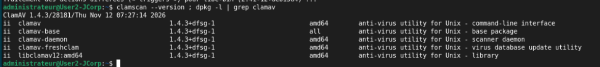

### 2.5 Téléchargement initial des signatures

Après l'installation, la base de signatures est vide : le moteur est en place mais il n'a encore rien à comparer. Une première mise à jour manuelle est donc nécessaire.

Le service `clamav-freshclam` démarre automatiquement à l'installation et maintient un verrou sur le répertoire des bases. Lancer `freshclam` à la main sans l'avoir arrêté provoque une erreur de verrou, d'où l'arrêt préalable du service.

```bash
sudo systemctl stop clamav-freshclam
sudo freshclam
```

Le service est ensuite remis en route et activé au démarrage, de façon à ce que la base reste à jour sans intervention :

```bash
sudo systemctl enable --now clamav-freshclam
```

**Résultat observé :** les trois bases sont annoncées `up-to-date`.

| Base | Version | Signatures |
| --- | --- | --- |
| `daily.cvd` | 28181 | 355 854 |
| `main.cvd` | 63 | 3 287 027 |
| `bytecode.cvd` | 339 | 80 |

Soit environ **3,64 millions de signatures** chargées.

#### Observation : les bases étaient déjà présentes

La commande `freshclam` n'a rien téléchargé, elle a constaté que les bases étaient à jour. L'explication se lit dans l'horodatage des fichiers : ils datent de **09 h 35**, c'est-à-dire du moment de l'installation, alors que ma commande manuelle a été lancée à **09 h 38**. Le service `clamav-freshclam` installé par APT a démarré tout seul et effectué le téléchargement initial avant que je l'arrête.

Ma commande manuelle n'a donc pas joué le rôle attendu de premier téléchargement, mais celui d'un **contrôle de fraîcheur**, ce qui reste une preuve valable pour la recette. L'étape conserve tout son sens : sur une machine où le service n'aurait pas pu sortir sur Internet, c'est bien cette commande qui aurait fait le travail et affiché l'erreur.

#### Observation : avertissement de version du moteur

La sortie contient un avertissement qu'il serait malhonnête de passer sous silence :

```
WARNING: Your ClamAV installation is OUTDATED!
WARNING: Local version: 1.4.3  Recommended version: 1.4.6
```

Le moteur installé depuis les dépôts Debian est en version 1.4.3, alors que le projet ClamAV publie la 1.4.6. Ce n'est **pas** un défaut de configuration de ma part, mais le fonctionnement normal d'une distribution stable : Debian fige la version d'un paquet pendant toute la durée de vie de la version stable et y rétroporte les correctifs de sécurité, plutôt que de suivre les versions amont.

Les conséquences concrètes sont les suivantes :

- **La détection n'est pas dégradée.** Ce qui détermine ce que l'antivirus reconnaît, ce sont les signatures, et elles sont à jour du jour même (base compilée le 12 novembre 2026 à 07 h 27).
- **Le moteur peut manquer des améliorations récentes**, notamment la prise en charge de nouveaux formats d'archives ou des corrections de performance.
- **Le compromis est acceptable** dans le contexte JCorp : la stabilité et l'application automatique des correctifs de sécurité Debian priment sur le fait de disposer de la toute dernière version amont. Installer le moteur depuis les sources imposerait de suivre ses mises à jour à la main sur chaque poste.

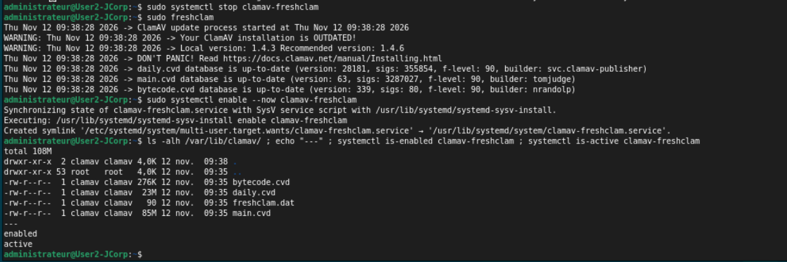

### 2.6 Contrôles de fin d'étape

```bash
ls -alh /var/lib/clamav/ ; echo "---" ; systemctl is-enabled clamav-freshclam ; systemctl is-active clamav-freshclam
```

| Contrôle | Résultat attendu | Résultat observé | Conforme |
| --- | --- | --- | --- |
| Présence des bases | `main.cvd`, `daily.cvd` et `bytecode.cvd` présents, propriétaire `clamav` | `main.cvd` 85 Mio, `daily.cvd` 23 Mio, `bytecode.cvd` 276 Kio, plus `freshclam.dat` ; tous appartenant à `clamav:clamav` | Oui |
| Volume occupé | De l'ordre d'une centaine de mébioctets | **108 Mio** au total | Oui |
| Démarrage automatique | `enabled` | `enabled` | Oui |
| Service en fonctionnement | `active` | `active` | Oui |

À l'activation, systemd signale une synchronisation avec un script de démarrage SysV (`systemd-sysv-install`). C'est normal : le paquet Debian fournit encore un script d'init historique en parallèle de l'unité systemd, et l'activation met les deux mécanismes en cohérence.

Le volume relevé de 108 Mio correspond bien à l'ordre de grandeur annoncé, et reste négligeable au regard des 23 Gio disponibles sur la racine.

---

## 3. Étape 2 — Mise en service du démon

### 3.1 Objectif

Activer `clamav-daemon` et contrôler son état, après avoir traité la contrainte de mémoire identifiée au chapitre 1.

### 3.2 Décision de dimensionnement

La mémoire de la VM 702 a été portée de 2 Gio à **4,8 Gio** avant le TP, ce que confirme le relevé de l'état initial à l'étape 1 : 4,8 Gio au total, dont 3,8 Gio disponibles une fois le bureau GNOME chargé.

Ce choix est motivé par le fonctionnement du démon : `clamd` charge l'intégralité des bases de signatures en mémoire et les y maintient, soit environ 1 Gio en régime permanent. Avec les 2 Gio d'origine, le démon aurait consommé la moitié de la mémoire de la machine et aurait concurrencé le bureau graphique, avec un risque d'arrêt par le mécanisme de protection contre l'épuisement mémoire du noyau (*OOM killer*).

La protection en temps réel étant un objectif du TP et reposant sur le démon, ce dimensionnement est un prérequis et non un confort.

| Paramètre | Avant | Après |
| --- | --- | --- |
| Mémoire de la VM 702 | 2 Gio | 4,8 Gio |

_Capture de la configuration matérielle dans Proxmox à ajouter : `images/etape2-memoire-vm.png`._

La mesure réalisée en 3.5 confirme a posteriori que cette décision était nécessaire.

### 3.3 Relevé de la mémoire avant activation

Pour chiffrer le coût réel du démon plutôt que de reprendre un ordre de grandeur trouvé dans la documentation, je relève l'état de la mémoire avant de l'activer.

```bash
free -h
```

**Résultat observé :** 4,8 Gio au total, 1,1 Gio utilisés, **3,7 Gio disponibles**.

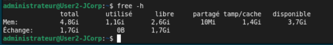

### 3.4 Activation et contrôle du service

```bash
sudo systemctl enable --now clamav-daemon
systemctl status clamav-daemon --no-pager
```

Comme pour `clamav-freshclam`, systemd synchronise l'unité avec le script de démarrage SysV encore fourni par le paquet Debian.

**Résultat observé :**

| Élément | Valeur relevée |
| --- | --- |
| État | `active (running)` depuis 09:55:48 |
| Démarrage automatique | `enabled` |
| Processus principal | PID 6348, `/usr/sbin/clamd --foreground=true` |
| Mémoire du service | **947,4 Mio** (pic identique) |
| Temps processeur consommé | 13,0 s |
| Déclenché par | `clamav-daemon.socket` |
| Fichier d'extension | `/etc/systemd/system/clamav-daemon.service.d/extend.conf` |

Deux éléments de cette sortie méritent une explication.

**L'activation par socket.** La ligne `TriggeredBy: clamav-daemon.socket` indique que le démon n'est pas simplement lancé au démarrage : systemd met en place la socket d'écoute et démarre `clamd` lorsqu'un client la sollicite. C'est le fonctionnement retenu par Debian, et il explique pourquoi le service peut apparaître à l'état `activating` pendant les premières dizaines de secondes : le temps processeur de 13 secondes relevé correspond au chargement des 3,64 millions de signatures en mémoire.

**Les étapes préalables.** Les deux lignes `ExecStartPre` créent le répertoire `/run/clamav` et en attribuent la propriété à l'utilisateur `clamav`. C'est ce répertoire qui accueillera la socket locale.

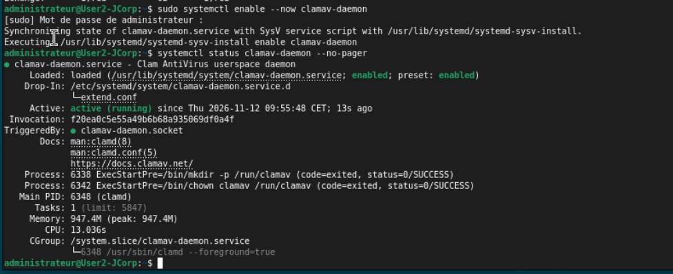

### 3.5 Processus et coût réel en mémoire

```bash
ps -edf | grep clam | grep -v grep
free -h
```

**Résultat observé :** deux processus, tous deux sous l'utilisateur non privilégié `clamav`.

| PID | Processus | Démarré à | Rôle |
| --- | --- | --- | --- |
| 5926 | `/usr/bin/freshclam -d --foreground=true` | 09:38 | Mise à jour des signatures en tâche de fond |
| 6348 | `/usr/sbin/clamd --foreground=true` | 09:55 | Moteur de détection résident |

Le fait que les deux tournent sous `clamav` et non sous `root` est un point de sécurité favorable : une faille dans le moteur d'analyse ne donnerait pas directement les privilèges administrateur sur le poste.

**Comparaison de la mémoire :**

| Moment | Utilisée | Disponible |
| --- | --- | --- |
| Avant activation | 1,1 Gio | 3,7 Gio |
| Après activation | 2,0 Gio | 2,8 Gio |
| **Écart** | **+0,9 Gio** | **−0,9 Gio** |

La mesure confirme l'ordre de grandeur annoncé au chapitre 1 et recoupe les 947,4 Mio rapportés par systemd. Elle valide surtout la décision de dimensionnement : sur la configuration d'origine à 2 Gio, le démon aurait occupé à lui seul près de la moitié de la mémoire de la machine, en concurrence directe avec le bureau GNOME. Dans la configuration retenue, il en consomme environ 20 % et laisse 2,8 Gio disponibles pour l'usage bureautique.

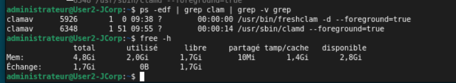

### 3.6 Mode de communication du démon

Le démon peut être joint de deux façons : par une **socket locale**, c'est-à-dire un fichier spécial accessible uniquement depuis la machine, ou par un **port TCP**, qui l'exposerait au réseau. La recommandation est d'utiliser la socket locale lorsque les clients se trouvent sur la même machine, ce qui est le cas ici.

```bash
grep -E '^(LocalSocket|TCPSocket|User|LogFile)' /etc/clamav/clamd.conf
clamdscan --version
```

**Résultat observé :**

| Directive | Valeur | Commentaire |
| --- | --- | --- |
| `LocalSocket` | `/var/run/clamav/clamd.ctl` | Communication par fichier de socket |
| `LocalSocketGroup` | `clamav` | Groupe propriétaire de la socket |
| `LocalSocketMode` | `666` | Permissions de la socket, voir ci-dessous |
| `User` | `clamav` | Compte de service non privilégié |
| `LogFile` | `/var/log/clamav/clamav.log` | Journal du démon |
| `TCPSocket` | **absente** | Aucune écoute réseau |

L'absence de `TCPSocket` est le point le plus important : le démon n'ouvre aucun port et n'est donc pas joignable depuis le réseau `10.2.101.0/24`. La surface d'attaque se limite à la machine elle-même.

#### Remarque sur les permissions de la socket

La valeur `LocalSocketMode 666` signifie que **tout utilisateur local** du poste peut écrire dans la socket, et donc demander une analyse au démon. Ce n'est pas la configuration la plus restrictive possible, mais c'est le réglage par défaut de Debian et il est cohérent avec l'usage visé :

- Sur un **poste de travail**, c'est ce qui permet à un utilisateur du domaine comme `jfernandes@ad.jcorp` d'analyser un fichier sans privilèges particuliers, et c'est une condition de fonctionnement de l'interface graphique ClamUI installée à l'étape 6.
- Sur un **serveur**, on resserrerait ce réglage à `660` en s'appuyant sur `LocalSocketGroup`, de façon à n'autoriser que les comptes explicitement ajoutés au groupe `clamav`, par exemple celui du serveur web.

Le risque résiduel sur un poste reste mesuré : un utilisateur local peut solliciter le moteur, pas en modifier la configuration ni lire des fichiers auxquels il n'a pas déjà accès. Je retiens donc le réglage par défaut et je documente l'arbitrage.

Enfin, `clamdscan --version` répond `ClamAV 1.4.3/28181/Thu Nov 12 07:27:14 2026`, soit exactement la même version et la même base qu'à l'étape 1. La nuance est importante : cette information n'est plus produite par un moteur chargé pour l'occasion, elle est **renvoyée par le démon**. Le dialogue entre le client et le service est donc opérationnel.

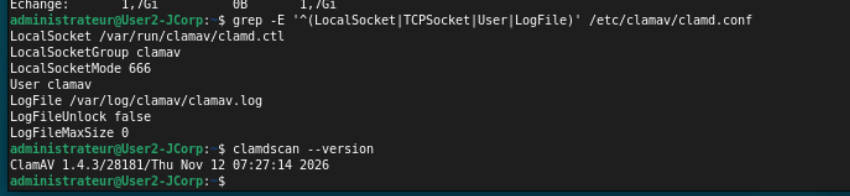

### 3.7 Contrôles de fin d'étape

| Contrôle | Résultat attendu | Résultat observé | Conforme |
| --- | --- | --- | --- |
| Service actif | `active (running)` | `active (running)` depuis 09:55:48 | Oui |
| Démarrage automatique | `enabled` | `enabled` | Oui |
| Compte d'exécution | Utilisateur non privilégié | `clamav` pour `clamd` et `freshclam` | Oui |
| Pas d'écoute réseau | Aucune directive `TCPSocket` | Absente, seule `LocalSocket` est définie | Oui |
| Dialogue client/démon | Version renvoyée par le démon | `ClamAV 1.4.3/28181` | Oui |
| Coût mémoire | De l'ordre de 1 Gio | 947,4 Mio, soit 0,9 Gio mesuré | Oui |

---

## 4. Étape 3 — Test de détection avec EICAR

### 4.1 Qu'est-ce que le fichier EICAR ?

Le fichier EICAR, du nom de l'*European Institute for Computer Antivirus Research*, est un **faux virus de test**. C'est un simple fichier texte qui ne contient aucun code malveillant, mais dont la chaîne de caractères est reconnue comme virus de test par la quasi-totalité des antivirus, ClamAV compris. Il permet donc de vérifier qu'une chaîne de détection complète fonctionne — scan, journalisation, alerte, quarantaine — sans jamais manipuler un véritable logiciel malveillant.

C'est la bonne pratique : on ne teste jamais un antivirus avec un vrai échantillon sur une machine de production ou de laboratoire reliée au réseau de l'entreprise.

> **Remarque sur ce dépôt :** la chaîne EICAR n'est volontairement pas recopiée telle quelle dans ce rapport, et le fichier `eicar.txt` est exclu par le `.gitignore`. Un dépôt contenant la signature complète serait signalé comme infecté par l'antivirus de tout poste qui le clone. Les commandes du TP reconstituent la chaîne par concaténation, ce qui produit exactement le même fichier au moment de l'exécution.

### 4.2 Préparation des fichiers de test

Je travaille dans un dossier dédié, de façon à ne rien supprimer d'autre lors du test de remédiation, et je crée **deux** fichiers : un faux virus et un fichier sain. Le second sert de témoin : il prouve que l'antivirus distingue les fichiers au lieu de tout signaler.

```bash
mkdir -p ~/tp-clamav && cd ~/tp-clamav
printf '%s%s' 'X5O!P%@AP[4\PZX54(P^)7CC)7}$EICAR-ST' 'ANDARD-ANTIVIRUS-TEST-FILE!$H+H*' > eicar.txt
echo 'Ceci est un fichier sain de test.' > sain.txt ; ls -l
```

**Résultat observé :** `eicar.txt` de **68 octets** et `sain.txt` de 34 octets, dans `/home/administrateur/tp-clamav`.

La taille de 68 octets est la taille canonique du fichier EICAR, ce qui confirme que la reconstitution par concaténation a bien produit la chaîne attendue.

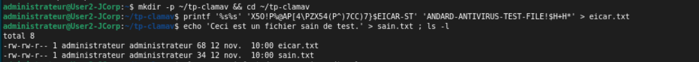

### 4.3 Détection sans suppression

Je commence par une analyse qui se contente de signaler, sans rien supprimer.

```bash
clamscan --infected --recursive ~/tp-clamav
```

| Option | Effet |
| --- | --- |
| `--infected` | N'affiche que les fichiers détectés |
| `--recursive` | Parcourt les sous-répertoires |

**Résultat observé :**

```
/home/administrateur/tp-clamav/eicar.txt: Eicar-Test-Signature FOUND
```

| Indicateur du résumé | Valeur |
| --- | --- |
| Signatures connues | 3 628 258 |
| Version du moteur | 1.4.3 |
| Répertoires analysés | 1 |
| Fichiers analysés | 2 |
| **Fichiers infectés** | **1** |
| Durée | 15,6 s |

Les deux fichiers ont été analysés et un seul est signalé : `sain.txt` n'apparaît pas, ce qui est le comportement attendu. Le nom de signature renvoyé est `Eicar-Test-Signature`, là où le tutoriel de référence mentionne `Eicar-Signature` : la dénomination a évolué entre les versions de la base, sans conséquence sur la détection.

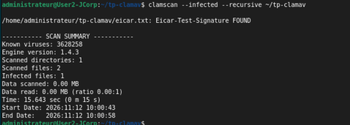

### 4.4 Comparaison de `clamscan` et de `clamdscan`

Le tableau du chapitre 1 oppose les deux outils sur le papier. Je vérifie ici l'écart réellement mesuré sur la machine, sur **le même fichier**.

```bash
time clamscan ~/tp-clamav/eicar.txt
time clamdscan --fdpass ~/tp-clamav/eicar.txt
```

L'option `--fdpass` transmet au démon le descripteur du fichier plutôt que son chemin. Elle est nécessaire ici : le démon tourne sous le compte `clamav` et n'a pas forcément accès au dossier personnel d'un utilisateur, alors que le descripteur, lui, est ouvert par le client qui dispose déjà des droits.

**Résultat observé :**

| Mesure | `clamscan` | `clamdscan --fdpass` |
| --- | --- | --- |
| Temps réel | **17,955 s** | **0,045 s** |
| Temps processeur utilisateur | 16,288 s | 0,011 s |
| Durée d'analyse annoncée | 17,929 s | 0,014 s |
| Détection | `Eicar-Test-Signature FOUND` | `Eicar-Test-Signature FOUND` |

Le rapport est d'environ **400 pour 1** sur un fichier de 68 octets.

La sortie de `clamscan` explique précisément d'où vient l'écart, puisqu'elle détaille sa phase de démarrage :

```
Loading:    14s   3.63M/3.63M sigs
Compiling:   3s   41/41 tasks
```

Soit 17 secondes consacrées au **chargement et à la compilation des signatures**, et une fraction de seconde à l'analyse elle-même. `clamscan` refait ce travail à chaque exécution, tandis que `clamdscan` interroge un démon qui a déjà tout en mémoire — ce qui est exactement ce que coûtent les 947 Mio mesurés à l'étape 2.

**Conséquence pratique pour l'exploitation :** le choix entre les deux outils n'est pas une affaire de préférence.

- Une analyse **fréquente ou déclenchée à la demande** doit passer par `clamdscan`, sinon chaque appel paie 17 secondes de chargement. C'est le cas du script lancé toutes les quelques minutes, de l'analyse d'un fichier déposé, ou d'un clic dans une interface graphique.
- Une analyse **massive et planifiée la nuit** peut utiliser `clamscan` : les 17 secondes de chargement sont négligeables devant la durée totale, et cela évite de maintenir un démon résident de près de 1 Gio sur une machine qui n'en a pas l'usage le reste du temps.

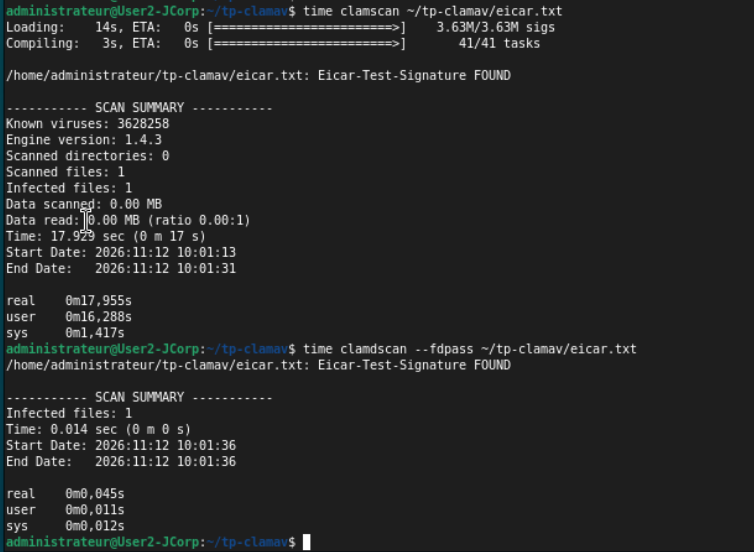

### 4.5 Suppression du fichier détecté et journalisation

```bash
clamscan --infected --remove --recursive ~/tp-clamav ; ls -l ~/tp-clamav
sudo tail -n 15 /var/log/clamav/clamav.log
```

L'option `--remove` supprime les fichiers détectés. Elle est employée ici sur un dossier de test ne contenant qu'un faux virus ; en exploitation réelle, on lui préfère `--move` vers une quarantaine, ce qui est mis en place à l'étape suivante.

**Résultat observé :** `eicar.txt: Removed.`, et le `ls` ne laisse plus que `sain.txt`. La détection débouche donc bien sur une remédiation effective, et le fichier sain n'a pas été touché.

#### Observation : toutes les analyses ne sont pas journalisées

Le journal `/var/log/clamav/clamav.log` relevé à l'étape 2 contient bien une trace de détection :

```
Thu Nov 12 10:01:36 2026 -> /home/administrateur/tp-clamav/eicar.txt:
Eicar-Test-Signature(44d88612fea8a8f36de82e1278abb02f:68) FOUND
```

L'entrée précise l'empreinte MD5 du fichier et sa taille en octets, ce qui permet d'identifier précisément l'élément détecté.

Mais en comparant les horodatages, un constat s'impose : **une seule des quatre analyses figure dans ce journal**, celle de 10:01:36, qui correspond exactement à l'exécution de `clamdscan`. Les trois analyses lancées avec `clamscan` (à 10:00:43, 10:01:13 et 10:01:51) n'y apparaissent pas.

L'explication tient à l'architecture décrite au chapitre 1 : ce fichier est le journal **du démon**. `clamscan` est un scanner autonome qui n'a aucun lien avec `clamd` ; il écrit sur la sortie standard et ne journalise que si on le lui demande explicitement avec l'option `--log`.

C'est un point à retenir pour l'exploitation : une détection faite par `clamscan` sans `--log` **ne laisse aucune trace** une fois le terminal fermé. Toute analyse planifiée devra donc écrire dans un fichier dédié, ce que je mets en place à l'étape 5.

Les lignes précédentes du journal, horodatées à 09:56:02, correspondent au démarrage du démon et énumèrent les formats pris en charge : exécutables Windows (`Portable Executable`), `ELF`, courriels, `OLE2`, `PDF`, `SWF`, `HTML`, `XMLDOCS`, `HWP3` et `OneNote`. Le démon signale également une auto-vérification toutes les 3 600 secondes, mécanisme par lequel il recharge ses signatures lorsque `freshclam` en a téléchargé de nouvelles — sans quoi la mise à jour des bases n'atteindrait jamais le processus résident.

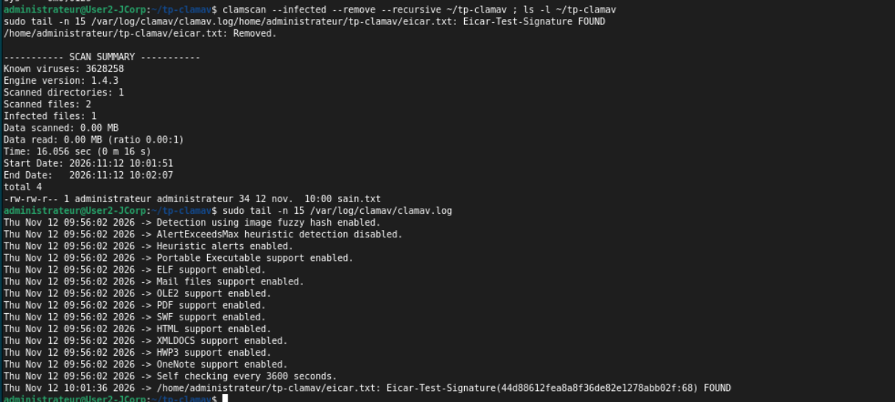

### 4.6 Contrôles de fin d'étape

| Contrôle | Résultat attendu | Résultat observé | Conforme |
| --- | --- | --- | --- |
| Détection | Le faux virus est signalé | `Eicar-Test-Signature FOUND` | Oui |
| Absence de faux positif | Le fichier sain n'est pas signalé | `sain.txt` jamais détecté ni supprimé | Oui |
| Remédiation | Le fichier détecté est supprimé | `Removed.`, confirmé par `ls` | Oui |
| Journalisation | La détection est tracée | Entrée avec empreinte MD5 et taille, pour l'analyse passée par le démon | Oui, avec la réserve ci-dessus |
| Écart de performance | `clamdscan` nettement plus rapide | 0,045 s contre 17,955 s, soit un rapport de 400 | Oui |

---

## 5. Étape 4 — Protection en temps réel et quarantaine

### 5.1 Objectif

Jusqu'ici, une analyse ne se déclenche que si quelqu'un la demande. L'**analyse à l'accès** (*On-Access Scanning*) change de logique : le composant `clamonacc` s'appuie sur le mécanisme de surveillance de fichiers du noyau Linux pour être averti dès qu'un fichier est écrit dans un répertoire surveillé, et le soumet aussitôt au démon. Aucune commande n'est lancée par l'utilisateur.

L'objectif est de surveiller un répertoire de téléchargement et de déplacer automatiquement en quarantaine tout fichier détecté.

### 5.2 Vérification du composant et repérage des dossiers

```bash
clamonacc --help | head -5 ; echo "---" ; ls -d /home/*/
```

**Résultat observé :** `bash: clamonacc : commande introuvable`.

Ce n'est pas un défaut d'installation : le binaire se trouve dans `/usr/sbin`, qui ne fait pas partie du `PATH` d'un compte non administrateur. C'est exactement la même situation que celle rencontrée lors de la jonction du poste au domaine, où `realm` devait être appelé par son chemin complet `/usr/sbin/realm`. Le composant est bien présent, comme le confirme son démarrage en 5.5 ; seul son appel direct depuis ce compte nécessiterait le chemin complet. Le service systemd créé plus loin utilise de toute façon `/usr/sbin/clamonacc`.

Le listage des dossiers personnels retourne :

```
/home/administrateur/   /home/jfernandes@ad.jcorp/
```

Les deux comptes disposent donc d'un dossier personnel : le compte local d'administration, et le compte Active Directory créé par `pam_mkhomedir` lors de la première connexion de Joshua Fernandes. **Je retiens le dossier du compte local** comme périmètre de ce TP, afin de pouvoir déclencher et observer la détection dans la même session. L'extension au dossier du compte du domaine est traitée en 5.8.

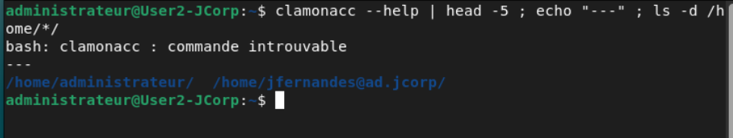

### 5.3 Préparation de la quarantaine

```bash
mkdir -p ~/Téléchargements
sudo mkdir -p /var/quarantine && sudo chmod 700 /var/quarantine && ls -ld /var/quarantine
```

**Résultat observé :** `drwx------ 2 root root /var/quarantine`.

Les permissions `700` sont un choix délibéré : la quarantaine contient des fichiers reconnus comme malveillants, et seul `root` doit pouvoir y accéder. Un utilisateur ne doit pouvoir ni les consulter, ni les exécuter, ni les restaurer de sa propre initiative.

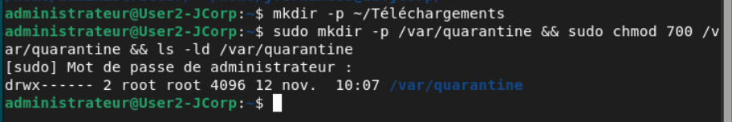

### 5.4 Configuration de la surveillance

Les directives de l'analyse à l'accès sont ajoutées à la fin de `/etc/clamav/clamd.conf`.

```bash
sudo tee -a /etc/clamav/clamd.conf > /dev/null <<'EOF'

# --- Analyse en temps reel, TP ClamAV du 12 novembre 2026 ---
OnAccessPrevention yes
OnAccessIncludePath /home/administrateur/Téléchargements
OnAccessExcludeUname clamav
OnAccessExcludeRootUID yes
EOF
```

| Directive | Rôle |
| --- | --- |
| `OnAccessPrevention yes` | Active l'analyse à l'accès |
| `OnAccessIncludePath` | Restreint la surveillance à ce répertoire ; la directive est répétable |
| `OnAccessExcludeUname clamav` | Exclut les accès réalisés par le compte de service |
| `OnAccessExcludeRootUID yes` | Exclut les accès réalisés par `root` |

Les deux dernières directives ne sont pas facultatives. Lorsque le démon analyse un fichier, il doit l'ouvrir pour le lire : cette ouverture est elle-même un accès, qui déclencherait une nouvelle analyse, qui provoquerait un nouvel accès, et ainsi de suite. Exclure le compte `clamav` rompt cette boucle. L'exclusion de `root` est recommandée sur un poste de travail, où l'essentiel de l'activité des utilisateurs se fait sous des comptes non privilégiés.

**Conséquence sur la procédure de test :** un fichier créé avec `sudo` ne sera pas détecté, puisque l'accès sera attribué à `root`. Le test de 5.6 est donc exécuté sous le compte utilisateur, sans élévation de privilèges.

Le contrôle de l'ajout révèle par ailleurs une directive déjà présente dans la configuration par défaut, juste au-dessus du bloc ajouté :

```bash
tail -8 /etc/clamav/clamd.conf
```

```
BytecodeTimeout 60000
OnAccessMaxFileSize 5M
```

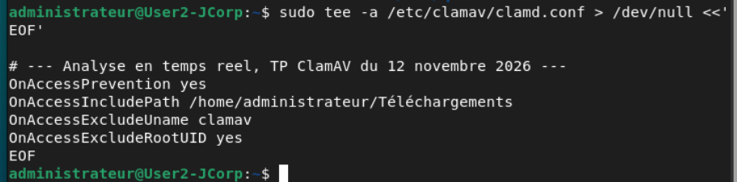

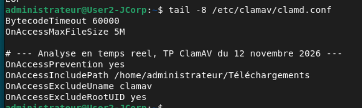

#### Limite relevée : `OnAccessMaxFileSize 5M`

Cette directive, présente par défaut dans la configuration Debian, signifie que **les fichiers de plus de 5 Mio ne sont pas analysés en temps réel**. Un logiciel malveillant dépassant cette taille serait donc écrit dans le répertoire surveillé sans déclencher de détection.

Ce réglage par défaut est un compromis de performance : l'analyse à l'accès est synchrone et un fichier volumineux retarderait l'opération d'écriture qui l'a déclenchée. Il a toutefois deux conséquences qu'il faut avoir en tête :

- La protection en temps réel ne constitue pas à elle seule une couverture complète. C'est l'une des raisons pour lesquelles **l'analyse planifiée de l'étape 5 reste nécessaire** : elle, n'applique pas cette limite de taille.
- Sur un serveur recevant des documents déposés par des tiers, cette valeur devrait être relevée en fonction de la taille maximale des fichiers acceptés par l'application.

Je conserve la valeur par défaut pour ce TP, et je la documente comme une limite connue plutôt que de laisser croire à une protection sans faille.

### 5.5 Service systemd dédié

Un service par défaut existe, mais j'en crée un personnalisé afin de maîtriser les options passées au scanner.

```bash
sudo tee /etc/systemd/system/clamonacc.service > /dev/null <<'EOF'
[Unit]
Description=ClamAV On-Access Scanner
Requires=clamav-daemon.service
After=clamav-daemon.service syslog.target network.target

[Service]
Type=simple
User=root
ExecStart=/usr/sbin/clamonacc -F --fdpass --log=/var/log/clamav/clamonacc.log --move=/var/quarantine
Restart=on-failure

[Install]
WantedBy=multi-user.target
EOF
```

| Élément | Rôle |
| --- | --- |
| `Requires` et `After` | Le scanner dépend du démon et ne démarre qu'après lui |
| `-F` | Maintient le processus au premier plan, systemd se chargeant de la supervision |
| `--fdpass` | Transmet le descripteur de fichier au démon, ce qui évite les refus d'accès dans les dossiers personnels |
| `--log` | Journal propre au temps réel, distinct de celui du démon |
| `--move` | Déplace en quarantaine au lieu de supprimer |
| `Restart=on-failure` | Relance le scanner en cas d'arrêt anormal |

Le choix de `--move` plutôt que d'une suppression est important en exploitation : il conserve la possibilité d'analyser l'élément détecté, de confirmer qu'il ne s'agit pas d'un faux positif et, le cas échéant, de le restituer à l'utilisateur.

L'activation respecte un ordre précis : le démon doit relire sa configuration **avant** que le scanner ne s'y connecte.

```bash
sudo systemctl daemon-reload && sudo systemctl restart clamav-daemon
sudo systemctl enable --now clamonacc && sleep 3 && systemctl status clamonacc --no-pager
```

**Résultat observé :**

| Élément | Valeur relevée |
| --- | --- |
| État | `active (running)` depuis 10:08:58 |
| Démarrage automatique | `enabled` |
| Processus principal | PID 6766, `/usr/sbin/clamonacc -F --fdpass --log=... --move=...` |
| Mémoire du service | **2,8 Mio** (pic 3 Mio) |
| Tâches | 8 |
| Temps processeur | 28 ms |

Le contraste avec les 947,4 Mio du démon est éclairant sur l'architecture retenue : `clamonacc` ne contient aucun moteur d'analyse. Il se contente de surveiller les événements du système de fichiers et de transmettre le travail à `clamd`. Le coût de la protection en temps réel n'est donc pas celui de ce service, mais celui du démon déjà mesuré à l'étape 2.

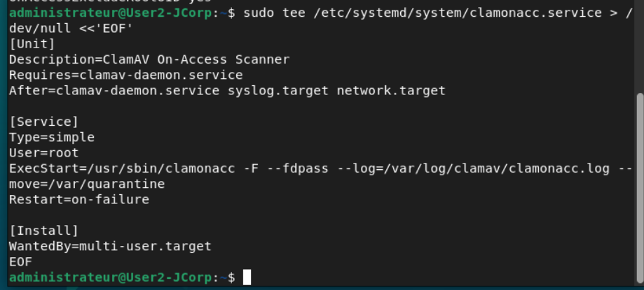

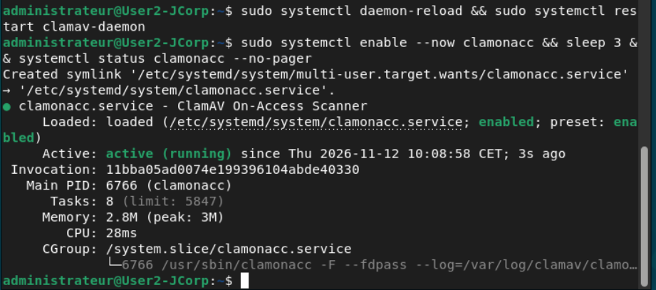

### 5.6 Test de la protection

Le journal du temps réel est affiché en continu dans un second terminal :

```bash
sudo tail -f /var/log/clamav/clamonacc.log
```

Le fichier de test est ensuite créé dans le répertoire surveillé, **sans élévation de privilèges**, pour les raisons exposées en 5.4 :

```bash
printf '%s%s' 'X5O!P%@AP[4\PZX54(P^)7CC)7}$EICAR-ST' 'ANDARD-ANTIVIRUS-TEST-FILE!$H+H*' > ~/Téléchargements/eicar.txt
ls -l ~/Téléchargements/ ; echo "---" ; sudo ls -l /var/quarantine/
```

**Résultat observé dans le journal :**

```
ClamInotif: watching '/home/administrateur/Téléchargements' (and all sub-directories)
/home/administrateur/Téléchargements/eicar.txt: Eicar-Test-Signature FOUND
/home/administrateur/Téléchargements/eicar.txt: moved to '/var/quarantine/eicar.txt'
```

**Résultat observé sur le système de fichiers :**

| Répertoire | Contenu |
| --- | --- |
| `~/Téléchargements/` | **vide** (`total 0`) |
| `/var/quarantine/` | `eicar.txt`, 68 octets, horodaté 10:13 |

La première ligne du journal confirme le périmètre effectivement surveillé, sous-répertoires compris. Les deux suivantes montrent la séquence complète : détection, puis déplacement.

Le point essentiel est qu'**aucune commande d'analyse n'a été lancée**. À l'étape 3, il fallait exécuter `clamscan` pour que la détection ait lieu ; ici, la simple écriture du fichier a suffi. C'est toute la différence entre une analyse à la demande et une protection en temps réel.

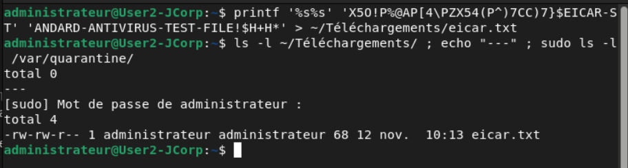

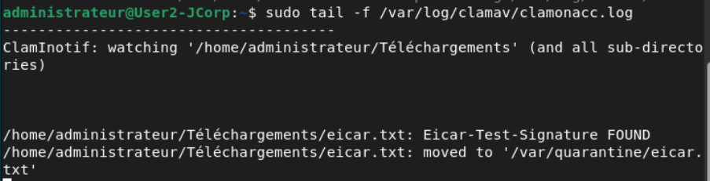

### 5.7 Contrôles de fin d'étape

| Contrôle | Résultat attendu | Résultat observé | Conforme |
| --- | --- | --- | --- |
| Service de temps réel actif | `active (running)` | PID 6766, actif depuis 10:08:58 | Oui |
| Périmètre surveillé | Le répertoire ciblé et ses sous-répertoires | Confirmé par la ligne `ClamInotif: watching` | Oui |
| Détection sans commande | Le fichier est signalé dès son écriture | `Eicar-Test-Signature FOUND` | Oui |
| Mise en quarantaine | Le fichier quitte le répertoire surveillé | Répertoire vide, fichier présent dans `/var/quarantine` | Oui |
| Protection de la quarantaine | Accès réservé à `root` | `drwx------ root root` | Oui |
| Journalisation dédiée | Trace dans `clamonacc.log` | Détection et déplacement tracés | Oui |

### 5.8 Limites de la configuration retenue et prolongements

Trois réserves sont à consigner pour que cette étape ne soit pas lue comme une protection complète du poste.

1. **Le périmètre est volontairement étroit.** Seul `/home/administrateur/Téléchargements` est surveillé. Le dossier personnel du compte du domaine, `/home/jfernandes@ad.jcorp`, existe mais n'est pas couvert. L'étendre consisterait à ajouter une seconde directive `OnAccessIncludePath`. Ce choix n'a pas été retenu ici afin de garder un test reproductible dans une seule session, mais il constituerait la première extension à apporter pour un poste réellement utilisé.
2. **La limite de taille de 5 Mio s'applique**, comme analysé en 5.4.
3. **La surveillance d'une arborescence large a un coût.** Étendre le périmètre à `/home` entier sur une machine à 2 vCPU imposerait d'exclure les répertoires de cache, à l'image de ce que recommande la documentation avec `OnAccessExcludePath`.

Ces trois points expliquent pourquoi l'analyse à l'accès ne remplace pas l'analyse planifiée mise en place à l'étape suivante : les deux mécanismes sont complémentaires, le premier réagissant immédiatement sur un périmètre restreint, le second balayant plus largement mais en différé.

---

## 6. Étape 5 — Analyse planifiée

### 6.1 Objectif et justification

L'analyse à l'accès de l'étape 4 réagit immédiatement, mais sur un périmètre restreint et avec une limite de taille de 5 Mio. L'analyse planifiée vient combler ces deux manques : elle balaye l'ensemble de `/home`, **y compris le dossier du compte du domaine** qui n'était pas surveillé, et n'applique aucune limite de taille.

Les deux mécanismes sont donc complémentaires et non redondants.

| | Temps réel (étape 4) | Planifié (étape 5) |
| --- | --- | --- |
| Déclenchement | Écriture d'un fichier | Horaire défini |
| Périmètre | Un répertoire | Tout `/home` |
| Limite de taille | 5 Mio | Aucune |
| Délai de détection | Immédiat | Jusqu'à une semaine |
| Outil | `clamonacc` + `clamd` | `clamscan` |

La planification repose sur un couple **service / timer** systemd plutôt que sur `cron` : le fichier `.service` définit **ce qui** doit être exécuté, le fichier `.timer` définit **quand**, et systemd assure le déclenchement. Cette séparation permet de lancer l'analyse à la demande sans toucher à sa planification, ce dont je me sers pour la tester en 6.5.

### 6.2 Création du service

```bash
sudo tee /etc/systemd/system/scan-home-hebdo.service > /dev/null <<'EOF'
[Unit]
Description=Scan ClamAV hebdomadaire de /home
Requires=clamav-daemon.service
After=clamav-daemon.service

[Service]
Type=oneshot
Nice=19
IOSchedulingClass=idle
ExecStart=/usr/bin/clamscan --recursive --infected --move=/var/quarantine --log=/var/log/clamav/scan-home-hebdo.log --exclude-dir="^/home/[^/]+/\.cache" /home
SuccessExitStatus=1
EOF
```

| Élément | Rôle |
| --- | --- |
| `Type=oneshot` | Tâche qui s'exécute puis se termine, par opposition à un service résident |
| `Nice=19` | Priorité processeur la plus basse |
| `IOSchedulingClass=idle` | Priorité disque la plus basse |
| `--log` | Journal dédié, **indispensable** : l'étape 3 a montré que `clamscan` ne trace rien sans cette option |
| `--move` | Quarantaine plutôt que suppression, par cohérence avec l'étape 4 |
| `--exclude-dir` | Exclut les répertoires de cache des utilisateurs |
| `SuccessExitStatus=1` | Voir l'explication en 6.5 |

Les réglages de priorité méritent d'être justifiés : l'analyse étant programmée à 2 h du matin, la machine peut être en train d'exécuter d'autres traitements. Ces deux directives garantissent que le scan cède le processeur et le disque à toute autre activité plutôt que de ralentir le système.

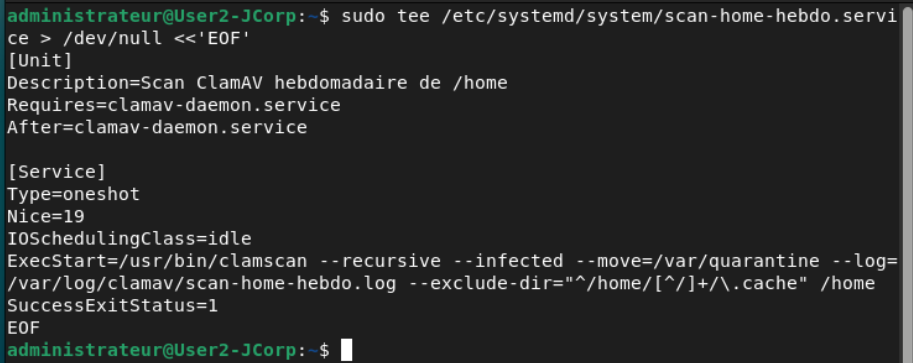

### 6.3 Création du timer

```bash
sudo tee /etc/systemd/system/scan-home-hebdo.timer > /dev/null <<'EOF'
[Unit]
Description=Lancer le scan ClamAV de /home chaque semaine

[Timer]
OnCalendar=Sun *-*-* 02:00:00
Persistent=true

[Install]
WantedBy=timers.target
EOF
```

`OnCalendar=Sun *-*-* 02:00:00` signifie « chaque dimanche à 2 h 00 ». `Persistent=true` rattrape l'exécution au démarrage suivant si la machine était éteinte à l'heure prévue. Cette dernière directive est particulièrement pertinente ici : la VM 702 est un poste de travail, qui n'a aucune raison d'être allumé un dimanche à 2 h du matin. Sans elle, l'analyse ne serait tout simplement jamais exécutée.

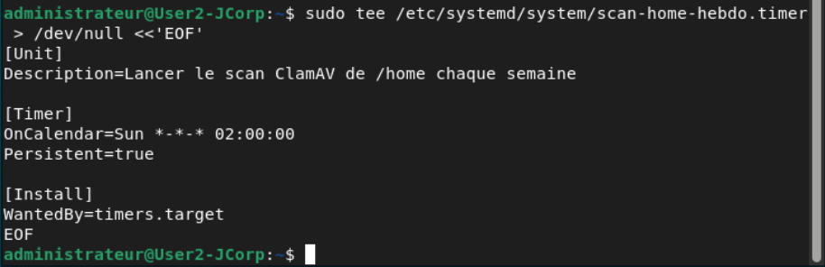

### 6.4 Contrôle de la planification

La syntaxe calendaire de systemd est vérifiable avant activation, ce qui évite de découvrir une erreur de planification des semaines plus tard.

```bash
systemd-analyze calendar "Sun *-*-* 02:00:00"
sudo systemctl daemon-reload && sudo systemctl enable --now scan-home-hebdo.timer && systemctl list-timers scan-home-hebdo.timer --no-pager
```

**Résultat observé :**

| Information | Valeur |
| --- | --- |
| Forme normalisée | `Sun *-*-* 02:00:00` |
| Prochaine exécution | dimanche 15 novembre 2026 à 02:00:00 CET |
| Équivalent UTC | dimanche 15 novembre 2026 à 01:00:00 |
| Délai | 2 jours |

Le timer apparaît ensuite dans la liste des minuteries actives, avec la colonne `LAST` et `PASSED` vides puisqu'il n'a encore jamais été déclenché, et la colonne `ACTIVATES` pointant vers `scan-home-hebdo.service`.

L'affichage conjoint de l'heure locale et de l'heure UTC n'est pas anecdotique : il confirme que systemd tient compte du fuseau horaire de la machine. Sur un poste joint au domaine et synchronisé par NTP, comme contrôlé à l'étape 1, la planification correspond donc bien à l'heure réelle attendue.

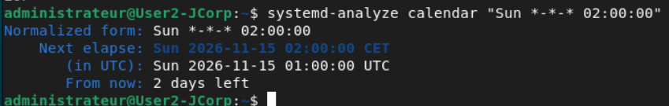

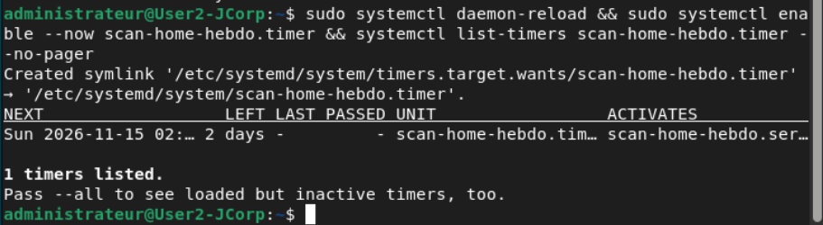

### 6.5 Test de l'analyse

Pour éprouver le mécanisme sans attendre dimanche, le service est lancé manuellement. Le fichier de test est placé dans `~/Documents` et **non** dans `~/Téléchargements` : ce dernier étant surveillé en temps réel depuis l'étape 4, le fichier aurait été mis en quarantaine instantanément et l'analyse planifiée n'aurait rien eu à détecter. C'est ici le mécanisme planifié que l'on vérifie, pas le temps réel.

```bash
mkdir -p ~/Documents && printf '%s%s' 'X5O!P%@AP[4\PZX54(P^)7CC)7}$EICAR-ST' 'ANDARD-ANTIVIRUS-TEST-FILE!$H+H*' > ~/Documents/eicar.txt && ls -l ~/Documents/
sudo systemctl start scan-home-hebdo.service
systemctl status scan-home-hebdo.service --no-pager ; sudo tail -n 20 /var/log/clamav/scan-home-hebdo.log ; ls -l ~/Documents/ ; sudo ls -l /var/quarantine/
```

**Résultat observé dans le journal dédié :**

```
/home/administrateur/Documents/eicar.txt: Eicar-Test-Signature FOUND
/home/administrateur/Documents/eicar.txt: moved to '/var/quarantine/eicar.txt.001'
```

| Indicateur du résumé | Valeur |
| --- | --- |
| Répertoires analysés | 112 |
| Fichiers analysés | 73 |
| Fichiers infectés | 1 |
| Données analysées | 0,27 Mo |
| Durée | 17,5 s |

Le fichier détecté a été renommé en `eicar.txt.001` lors du déplacement, le nom `eicar.txt` étant déjà occupé dans la quarantaine depuis l'étape 4. Ce n'est pas une anomalie mais le comportement normal de `--move`, et c'est un comportement souhaitable : il évite qu'une détection en écrase une précédente et préserve l'historique des éléments mis à l'écart.

| Répertoire | Contenu final |
| --- | --- |
| `~/Documents/` | **vide** |
| `/var/quarantine/` | `eicar.txt` (10:13, étape 4) et `eicar.txt.001` (10:17, étape 5) |

#### Observation : `status=1/FAILURE` n'est pas un échec

La sortie de `systemctl status` affiche une ligne qui pourrait inquiéter :

```
Process: 7113 ExecStart=/usr/bin/clamscan ... (code=exited, status=1/FAILURE)
```

Pourtant l'unité est bien à l'état `inactive (dead)` et non `failed`. L'explication tient à la convention de codes de retour de `clamscan` : il renvoie **0** si rien n'est trouvé, **1** si au moins un fichier est infecté, et **2** en cas d'erreur. Trouver un virus est donc, du point de vue du système, un code de sortie non nul.

C'est précisément le rôle de la directive `SuccessExitStatus=1` ajoutée au service : elle indique à systemd de considérer le code 1 comme un succès. La mention `1/FAILURE` n'est que l'étiquette générique que systemd associe à tout code de sortie non nul dans le détail du processus ; le verdict de l'unité, lui, figure sur la ligne `Active`. Sans cette directive, chaque détection aurait marqué le service en échec, ce qui aurait rendu toute supervision de la tâche inexploitable — on ne saurait plus distinguer une analyse qui a trouvé quelque chose d'une analyse qui s'est mal passée.

#### Observation : le coût mémoire cumulé

Le service rapporte un pic mémoire de **958,3 Mio** et 17,4 s de temps processeur, ce qui correspond au chargement des signatures par `clamscan` mesuré à l'étape 3.

Ce chiffre s'ajoute aux 947,4 Mio déjà occupés en permanence par le démon : pendant l'exécution de l'analyse planifiée, la machine mobilise donc près de **1,9 Gio** rien que pour l'antivirus. Sur la configuration d'origine à 2 Gio, cette seule étape aurait saturé la mémoire. La décision de dimensionnement prise à l'étape 2 trouve ici sa justification la plus nette.

Une optimisation est possible : utiliser `clamdscan --fdpass` à la place de `clamscan` dans le service ferait porter l'analyse par le démon déjà chargé, supprimant ce second gigaoctet et les 17 secondes de chargement. Je conserve toutefois `clamscan` pour cette analyse planifiée, afin que la tâche reste **indépendante de l'état du démon** : si `clamd` est arrêté pour une raison quelconque, l'analyse hebdomadaire s'exécute quand même. C'est un arbitrage entre consommation et robustesse, tranché ici en faveur de la robustesse puisque l'analyse a lieu la nuit.

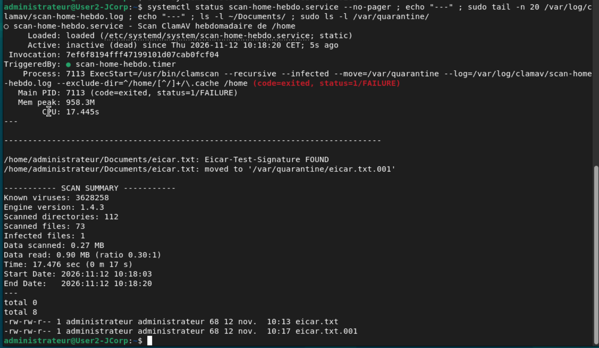

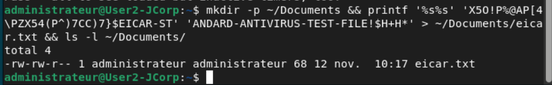

### 6.6 Contrôles de fin d'étape

| Contrôle | Résultat attendu | Résultat observé | Conforme |
| --- | --- | --- | --- |
| Syntaxe de la planification | Date cohérente avec l'intention | Dimanche 15 novembre 2026 à 02:00 CET | Oui |
| Timer actif | Présent dans la liste des minuteries | Actif, prochaine exécution dans 2 jours | Oui |
| Exécution de l'analyse | Parcours de `/home` | 112 répertoires et 73 fichiers analysés | Oui |
| Détection | Le fichier de test est signalé | `Eicar-Test-Signature FOUND` | Oui |
| Mise en quarantaine | Déplacement sans écrasement | `eicar.txt.001` créé à côté de `eicar.txt` | Oui |
| Journalisation dédiée | Trace dans `scan-home-hebdo.log` | Détection, déplacement et résumé complet | Oui |
| Verdict du service | Unité non en échec malgré la détection | `inactive (dead)`, grâce à `SuccessExitStatus=1` | Oui |

La couverture du dossier personnel du compte du domaine est assurée par le périmètre `/home`, ce qui comble la limite relevée en 5.8.

---

## 7. Étape 6 — Interface graphique ClamUI

### 7.1 Ce qu'est ClamUI

ClamAV ne dispose pas d'interface graphique officielle. ClamUI est un projet open source construit avec GTK et libadwaita, qui s'intègre nativement à un bureau GNOME comme celui de la VM 702. Il ne s'agit **pas** d'un second moteur antivirus : ClamUI est une surcouche qui appelle `clamscan`, `clamdscan`, `freshclam` et `clamonacc` à la place de l'utilisateur et présente les résultats dans une interface lisible, avec en plus un tableau de bord d'audit de sécurité du système.

Son intérêt dans le contexte JCorp est précisément celui d'un poste de travail : un utilisateur comme Joshua Fernandes doit pouvoir analyser une clé USB ou un téléchargement sans ouvrir de terminal.

### 7.2 Version retenue et écart avec le tutoriel

Le tutoriel suivi décrit la version **0.2.0** et signale deux difficultés : un défaut d'élévation de privilèges sur la distribution Flatpak, et un paquet `.deb` qui refuse de s'installer sur Debian 13 parce que sa dépendance `policykit-1` n'existe plus dans cette version de la distribution.

Je retiens donc la version **0.6.0**, publiée le 11 novembre 2026, qui règle ce point en séparant l'application et son composant privilégié en deux paquets distincts :

| Paquet | Rôle |
| --- | --- |
| `clamui_0.6.0_amd64.deb` | Application de bureau |
| `clamui-privileged-helper_0.6.0_amd64.deb` | Composant privilégié, nécessaire aux opérations demandant une élévation (configuration du temps réel, écriture de `clamd.conf`) |

L'installation par Flatpak est écartée pour cette raison. Cet écart avec le tutoriel est assumé et documenté : reprendre la version du tutoriel aurait conduit à un échec d'installation sur Debian 13.

### 7.3 Téléchargement et vérification d'intégrité

Trois fichiers sont récupérés depuis les publications du projet : les deux paquets et le fichier d'empreintes qui les accompagne.

```bash
mkdir -p ~/clamui && cd ~/clamui
wget -q --show-progress \
  https://github.com/linx-systems/clamui/releases/download/v0.6.0/clamui_0.6.0_amd64.deb \
  https://github.com/linx-systems/clamui/releases/download/v0.6.0/clamui-privileged-helper_0.6.0_amd64.deb \
  https://github.com/linx-systems/clamui/releases/download/v0.6.0/SHA256SUMS
ls -lh
```

**Résultat observé :** `clamui_0.6.0_amd64.deb` (13,06 Mio), `clamui-privileged-helper_0.6.0_amd64.deb` (517,52 Kio) et `SHA256SUMS` (1,37 Kio).

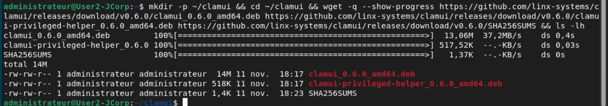

#### Pourquoi contrôler l'empreinte

Les paquets installés jusqu'ici provenaient des dépôts Debian : APT vérifie automatiquement leur signature cryptographique, et une altération en transit ou sur un miroir compromis serait détectée sans intervention de ma part. Ce n'est pas le cas ici : ces deux fichiers sont téléchargés en dehors de ce mécanisme, et rien ne les authentifie par défaut.

Installer un paquet `.deb` revient à exécuter du code avec les privilèges d'administrateur sur la machine. Dans un travail portant sur la sécurité, contrôler l'empreinte avant installation n'est donc pas une formalité : c'est la seule garantie que le fichier reçu est bien celui publié par le projet.

```bash
sha256sum -c --ignore-missing SHA256SUMS
```

**Résultat observé :**

```
clamui-privileged-helper_0.6.0_amd64.deb: Réussi
clamui_0.6.0_amd64.deb: Réussi
```

L'option `--ignore-missing` est nécessaire car le fichier `SHA256SUMS` couvre l'ensemble des formats publiés par le projet, dont l'AppImage, les paquets RPM et les variantes ARM que je n'ai pas téléchargés. Sans elle, la commande signalerait ces absences comme des échecs.

Les deux empreintes correspondent. Elles ont par ailleurs été recoupées avec celles publiées sur la page de la version, de façon à ne pas se contenter d'un fichier d'empreintes téléchargé depuis la même source que les paquets.

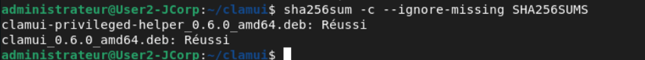

### 7.4 Installation

Les deux paquets sont installés en une seule commande, ce qui permet à APT de résoudre leurs dépendances ensemble.

```bash
sudo apt install -y ./clamui_0.6.0_amd64.deb ./clamui-privileged-helper_0.6.0_amd64.deb
```

**Résultat observé :** deux paquets installés, 14,2 Mo, aucune dépendance manquante. Les déclencheurs de `desktop-file-utils`, `hicolor-icon-theme` et `gnome-menus` sont exécutés : c'est ce qui intègre l'application au menu du bureau GNOME.

Le choix de la version 0.6.0 est validé par ce résultat : aucune erreur liée à `policykit-1`, contrairement à ce que produirait la version 0.2.0 du tutoriel sur Debian 13.

La commande se termine par un avertissement sans conséquence :

```
Notification : Le téléchargement est effectué en dehors du bac à sable en tant que
superutilisateur car le fichier n'est pas accessible par l'utilisateur « _apt »
```

APT utilise normalement un compte non privilégié, `_apt`, pour récupérer les fichiers, par précaution. Ce compte n'ayant pas accès au dossier personnel de l'utilisateur, APT signale qu'il a lu les paquets directement en tant que `root`. C'est une information, pas une erreur, et elle disparaîtrait si les fichiers étaient placés dans un répertoire comme `/tmp`.

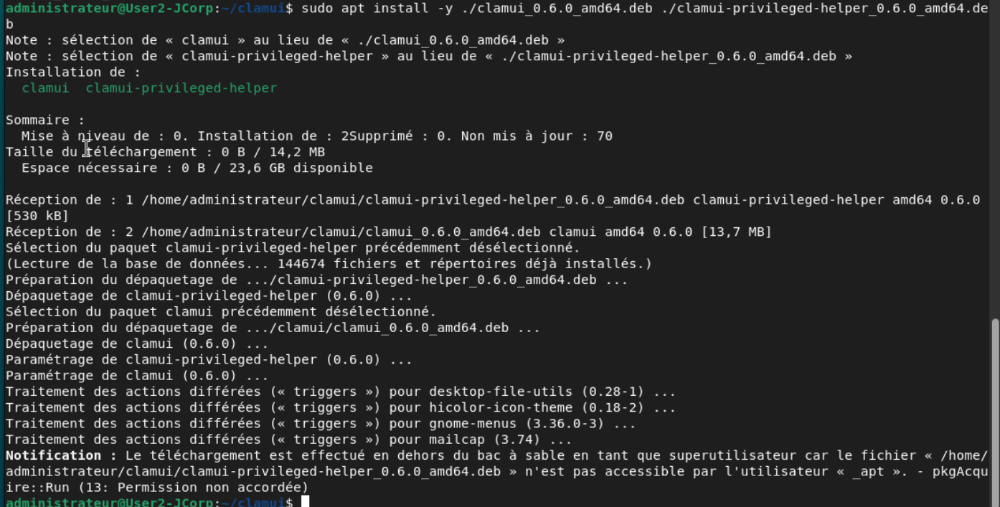

### 7.5 Préparation du test depuis l'interface

Un fichier de test est créé dans `~/Documents`, répertoire qui n'est pas surveillé en temps réel. Il reste donc en place jusqu'à ce qu'une analyse soit déclenchée, ce qui permettra de la lancer depuis l'interface graphique.

```bash
printf '%s%s' 'X5O!P%@AP[4\PZX54(P^)7CC)7}$EICAR-ST' 'ANDARD-ANTIVIRUS-TEST-FILE!$H+H*' > ~/Documents/test-clamui.txt
```

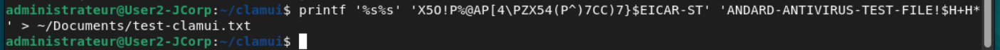

### 7.6 Prise en main de l'interface

L'application se lance depuis le menu des applications GNOME. Sa barre latérale organise les fonctions en huit sections : Analyse, Base virale, Journaux, Composants, Quarantaine, Statistiques, Audit et Réseau.

#### Composants

L'écran *Composants* dresse l'inventaire des outils ClamAV présents sur la machine. Il détecte correctement la famille de système hôte (`debian`) et affiche, pour chaque outil, sa version.

| Composant | Binaire | État rapporté |
| --- | --- | --- |
| Analyseur antivirus | `clamscan` | Installé, `ClamAV 1.4.3/28181/Thu Nov 12 07:27:14 2026` |
| Outil de mise à jour | `freshclam` | Installé, même version |
| Client du démon | `clamdscan` | Installé, même version |
| Démon d'analyse | `clamd` | **En cours d'exécution**, version indisponible |

Ces valeurs concordent exactement avec celles relevées en ligne de commande aux étapes 1 et 2, ce qui confirme que l'interface interroge bien la même installation. La mention « version indisponible » pour `clamd` n'est pas un défaut : contrairement aux trois autres, le démon ne s'interroge pas par une option en ligne de commande, et l'interface se replie sur l'état du service — qu'elle rapporte correctement comme actif.

Un encadré précise par ailleurs que « ClamUI n'installe jamais de paquets ni ne démarre de services à votre place » : l'interface se contente de piloter et de proposer des commandes à copier. C'est cohérent avec sa nature de surcouche, décrite en 7.1.

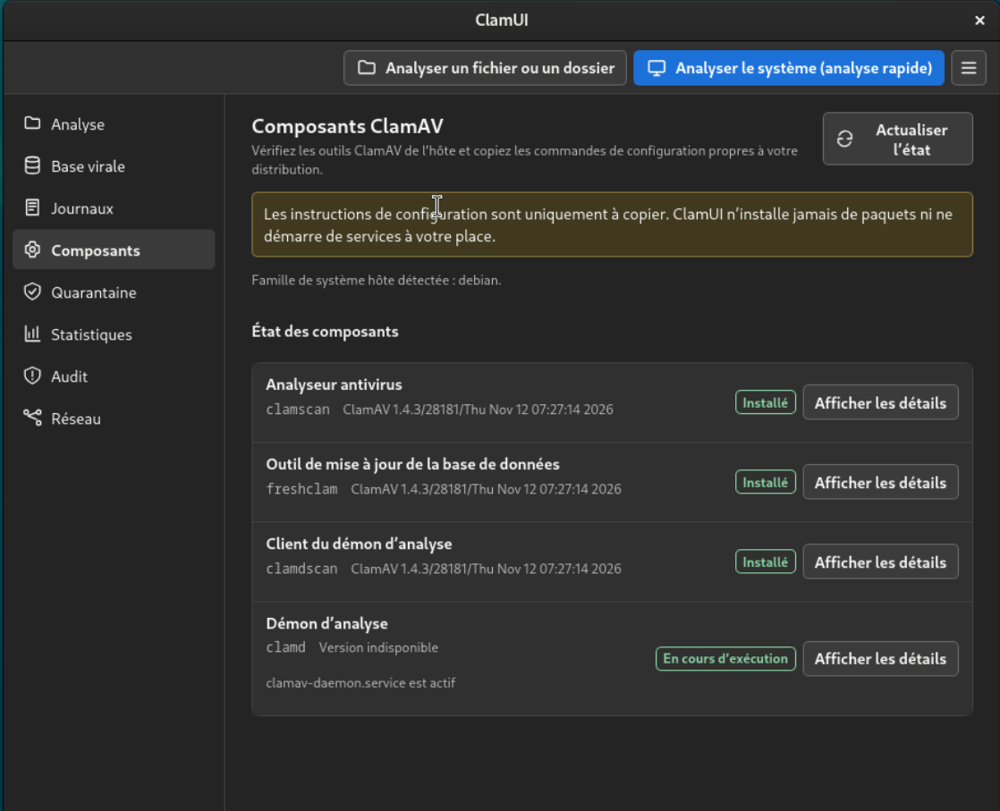

#### Base virale

Cet écran reprend l'état des signatures et permet de déclencher une mise à jour. Il rapporte le service `freshclam` comme **actif avec le PID 5926**, exactement l'identifiant relevé par `ps` à l'étape 2, et la base de données comme disponible « il y a 0 jour ».

Deux modes de mise à jour sont proposés : une mise à jour normale, qui demande au service actif de travailler, et une mise à jour forcée qui contourne le service et prépare des bases de remplacement avant de les mettre en service, avec restauration des précédentes en cas d'échec. La mise à jour normale lancée depuis l'interface retourne `État : success` et « 0 base de données mise à jour », ce qui est attendu puisque les bases dataient du matin même.

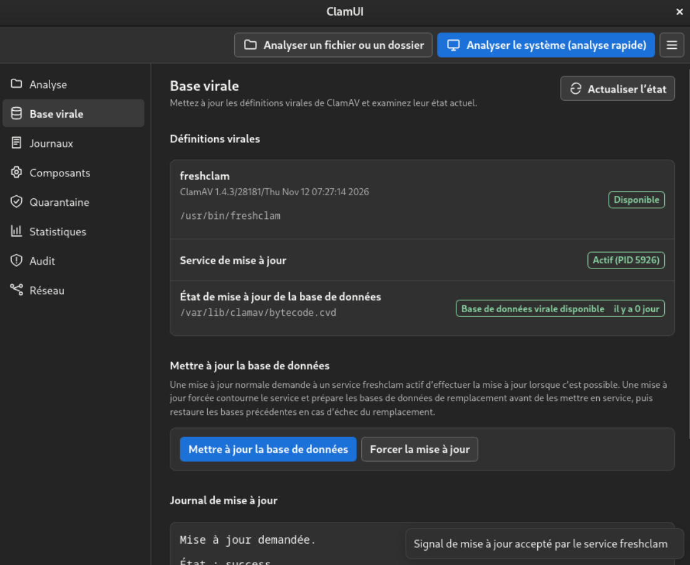

#### Journaux

L'historique recense les opérations réalisées depuis l'interface, chacune avec son horodatage et son verdict. Il distingue l'historique propre à ClamUI de l'onglet « Démon ClamAV », qui donne accès au journal du démon — celui-là même consulté en ligne de commande à l'étape 3.

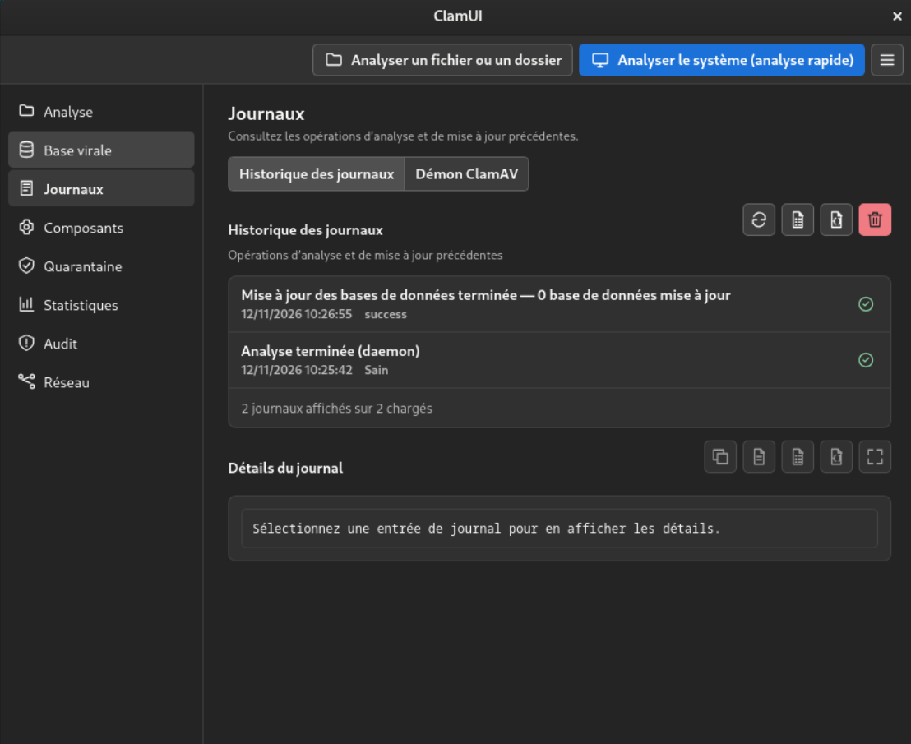

#### Audit de sécurité du système

C'est la fonction qui dépasse le strict cadre de l'antivirus. L'audit examine la configuration de sécurité du poste et classe ses contrôles en quatre catégories.

| Catégorie | Nombre |
| --- | --- |
| Problèmes | **0** |
| Avertissements | 3 |
| Contrôles satisfaits | 7 |
| Contrôles non applicables | 12 |

Les quatre contrôles relatifs à ClamAV sont tous satisfaits : installation détectée, base virale à jour, démon en cours d'exécution et mises à jour automatiques actives. Ils valident par un chemin indépendant l'ensemble du travail des étapes 1 et 2.

Les avertissements portent sur le **pare-feu** : l'état d'UFW n'a pas pu être examiné, et aucun Firewalld n'est détecté. Ce constat est exact et mérite d'être retenu plutôt que minimisé — aucun pare-feu local n'est configuré sur ce poste. Dans le contexte JCorp, le filtrage repose aujourd'hui sur le pare-feu activé au niveau de la carte réseau de la VM dans Proxmox, et non sur le système invité. L'ajout d'un pare-feu local constituerait un durcissement complémentaire, qui sort du périmètre de ce TP mais qui est noté comme piste d'amélioration.

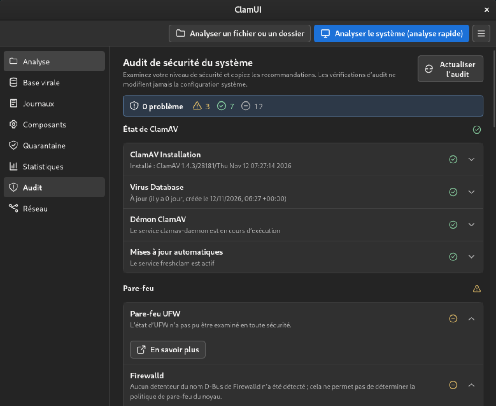

#### Connexions réseau

Cet écran liste les ports en écoute et les connexions établies à un instant donné. Il permet un contrôle intéressant : **aucun port n'est associé au démon ClamAV**, ce qui confirme par un second moyen l'absence de directive `TCPSocket` relevée à l'étape 2. Le démon n'est joignable que par sa socket locale.

Les connexions visibles correspondent au fonctionnement normal du poste : un échange UDP entre `10.2.101.11:68` et `10.2.101.1:67`, soit le client DHCP dialoguant avec la passerelle, et une écoute sur le port 5353 utilisé par la découverte de services du réseau local.

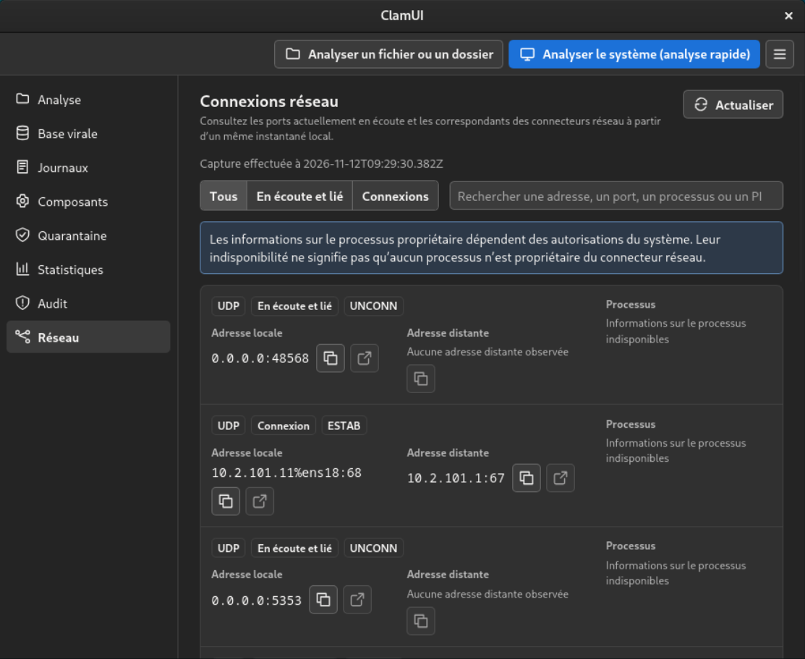

### 7.7 Deux écarts constatés entre l'interface et la ligne de commande

La prise en main fait apparaître deux différences de comportement qu'il serait trompeur de passer sous silence. Elles ne traduisent pas un dysfonctionnement, mais une séparation entre ce que pilote l'interface et ce que font les services configurés aux étapes 4 et 5.

#### Écart 1 — La quarantaine de l'interface est vide

L'écran *Quarantaine* annonce « 0 élément » et « Aucun fichier en quarantaine », alors que le dossier `/var/quarantine` contient bien les deux fichiers mis à l'écart aux étapes 4 et 5, comme l'a confirmé `sudo ls -l /var/quarantine/`.

L'explication tient à l'architecture de l'outil : **ClamUI gère son propre espace de quarantaine**, alimenté par les détections qu'il réalise lui-même, et dans lequel il conserve les métadonnées nécessaires à une restauration sécurisée — notamment l'empreinte du fichier, qui lui permet de vérifier qu'un élément restauré est bien celui qui avait été isolé. Il ne lit pas le répertoire `/var/quarantine` que nous avons imposé à `clamonacc` et au service planifié par l'option `--move`.

**Il existe donc deux quarantaines distinctes sur ce poste :**

| Quarantaine | Alimentée par | Consultable depuis |
| --- | --- | --- |
| `/var/quarantine` | `clamonacc` (temps réel) et le service planifié | Ligne de commande, en tant que `root` |
| Espace interne de ClamUI | Détections réalisées depuis l'interface | L'interface uniquement |

C'est un point d'exploitation important : un administrateur qui ne consulterait que l'interface **passerait à côté des détections faites par les services automatiques**. Deux solutions sont envisageables pour un poste réellement exploité : configurer ClamUI pour qu'il utilise `/var/quarantine`, si l'application le permet, ou retenir une seule des deux chaînes de traitement plutôt que de les faire coexister. Je retiens la seconde approche comme la plus saine : les services systemd assurent la protection de fond, et l'interface sert à la consultation et aux analyses ponctuelles.

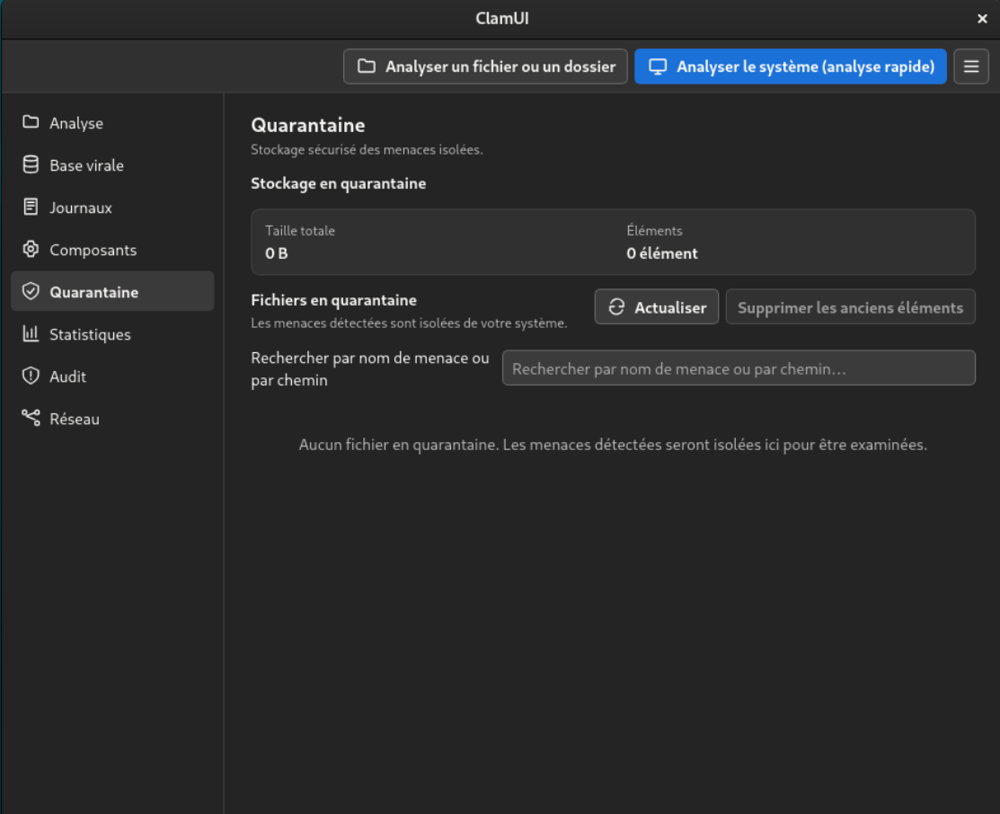

#### Écart 2 — Une analyse « saine » qui n'a rien analysé

L'écran *Analyse* affiche « Analyse terminée — aucune menace détectée » avec le verdict **Sain**. Mais la ligne juste en dessous indique : **« 0 fichier analysé, 0 menace »**.

Le profil utilisé, « Analyse rapide », cible `/home/administrateur/Téléchargements`. Or ce répertoire est **vide** depuis l'étape 4, puisque le fichier de test qui s'y trouvait a été déplacé en quarantaine par la protection en temps réel. L'analyse n'avait donc rien à examiner, et le fichier `test-clamui.txt` préparé en 7.5 se trouve dans `~/Documents`, en dehors de la cible du profil.

L'écran *Statistiques* reprend le même constat et le présente comme un état rassurant : « Le système est protégé », avec 1 analyse, **0 fichier analysé** et 0 menace détectée.

C'est une leçon qui dépasse l'outil : **un verdict « sain » n'a de valeur que rapporté au périmètre réellement analysé.** Un tableau de bord affichant « protégé » après une analyse ayant porté sur zéro fichier donne une fausse assurance. En exploitation, le nombre de fichiers analysés est un indicateur au moins aussi important que le nombre de menaces trouvées : un effondrement soudain de ce compteur signale un problème de configuration, pas une amélioration de la sécurité.

Cet écart est corrigé en 7.8 par une analyse portant sur une cible contenant effectivement un fichier à détecter.

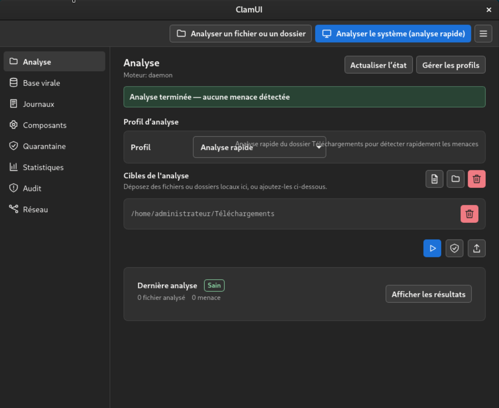

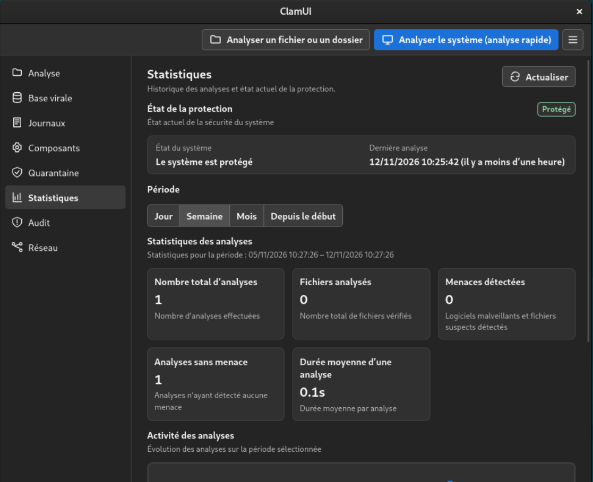

### 7.8 Analyse d'une cible non vide depuis l'interface

_Section à compléter : analyse de `~/Documents` depuis l'interface, détection de `test-clamui.txt` et traitement de l'élément détecté._

---

## 8. Étape 7 — Recette

Tableau de validation à compléter au fur et à mesure. Un contrôle n'est déclaré conforme que si sa preuve est enregistrée.

| N° | Contrôle | Résultat attendu | Résultat | Preuve |
| --- | --- | --- | --- | --- |
| 1 | Moteur installé | Version de `clamscan` affichée | **Conforme** — ClamAV 1.4.3, paquets `1.4.3+dfsg-1` à l'état `ii` | `etape1-version-moteur.png` |
| 2 | Signatures présentes | Trois bases `.cvd` dans `/var/lib/clamav/` | **Conforme** — 108 Mio, environ 3,64 millions de signatures, base du jour | `etape1-freshclam-controles.png` |
| 3 | Mise à jour automatique | `clamav-freshclam` `enabled` et `active` | **Conforme** | `etape1-freshclam-controles.png` |
| 4 | Démon opérationnel | `clamav-daemon` `active (running)` | **Conforme** — PID 6348, 947,4 Mio, sous le compte `clamav` | `etape2-daemon-status.png` |
| 4 bis | Exposition réseau du démon | Aucune écoute TCP | **Conforme** — socket locale uniquement | `etape2-socket-locale.png` |
| 5 | Détection à la demande | EICAR détecté par `clamscan` | **Conforme** — `Eicar-Test-Signature FOUND`, fichier sain non signalé | `etape3-scan-eicar.png` |
| 5 bis | Remédiation | Le fichier détecté est supprimé | **Conforme** — `Removed.` | `etape3-suppression-journal.png` |
| 5 ter | Écart `clamscan` / `clamdscan` | Le client du démon est plus rapide | **Conforme** — 0,045 s contre 17,955 s | `etape3-comparaison-scan.png` |
| 6 | Détection en temps réel | EICAR détecté et déplacé en quarantaine dès son écriture | **Conforme** — aucune commande d'analyse lancée | `etape4-journal-tempsreel.png` |
| 6 bis | Protection de la quarantaine | Accès réservé à `root` | **Conforme** — `drwx------ root root` | `etape4-quarantaine.png` |
| 7 | Journalisation | Détection tracée dans le journal correspondant | **Conforme** — empreinte MD5 et taille dans `clamav.log` ; `clamscan` ne journalise pas sans `--log` | `etape3-suppression-journal.png` |
| 8 | Analyse planifiée | *Timer* actif et prochaine exécution affichée | **Conforme** — dimanche 15 novembre 2026 à 02:00 CET | `etape5-timer-actif.png` |
| 8 bis | Exécution de l'analyse | Détection et mise en quarantaine | **Conforme** — 73 fichiers analysés, `eicar.txt.001` en quarantaine | `etape5-resultat-scan.png` |
| 9 | Interface graphique | ClamUI lancé, état du moteur et des signatures affiché | **Conforme** — version et base identiques aux relevés en ligne de commande | `etape6-clamui-composants.png` |
| 9 bis | Audit de sécurité | Diagnostic du poste affiché | **Conforme** — 0 problème, 3 avertissements sur le pare-feu | `etape6-clamui-audit.png` |
| 9 ter | Absence d'écoute réseau | Aucun port associé au démon | **Conforme** — confirme le contrôle 4 bis par un second moyen | `etape6-clamui-reseau.png` |
| 10 | Scan depuis l'interface | Analyse déclenchée et menace détectée | **Non concluant** — analyse réalisée sur un répertoire vide, 0 fichier analysé ; à refaire sur une cible non vide | `etape6-clamui-analyse.png` |
| 10 bis | Cohérence des quarantaines | Les détections automatiques visibles dans l'interface | **Non conforme** — l'interface gère une quarantaine distincte de `/var/quarantine` ; écart documenté en 7.7 | `etape6-clamui-quarantaine.png` |

---

## 9. Limites et conclusion

_Section à rédiger en fin de TP. Points à traiter :_

- ClamAV repose principalement sur des signatures : il est efficace sur les menaces connues, mais nettement moins sur les attaques du jour et les variantes fortement obfusquées. Ce n'est pas un EDR.
- L'outil est conçu avant tout pour des serveurs Linux ; sur un poste de travail il apporte une protection utile mais partielle.
- Le coût en CPU, en mémoire et en temps d'analyse est réel, ce qu'illustre concrètement la contrainte de mémoire rencontrée sur la VM 702.
- ClamAV doit être considéré comme une brique parmi d'autres, aux côtés du filtrage en amont, du durcissement du système, du contrôle des accès et de la sensibilisation des utilisateurs.
- Prolongement possible dans le projet JCorp : remonter l'état de l'antivirus et les détections vers la supervision Grafana/Prometheus prévue en atelier professionnel 1, afin de ne plus dépendre d'un contrôle poste par poste.

---

[Retour à la présentation du TP](README.md)
