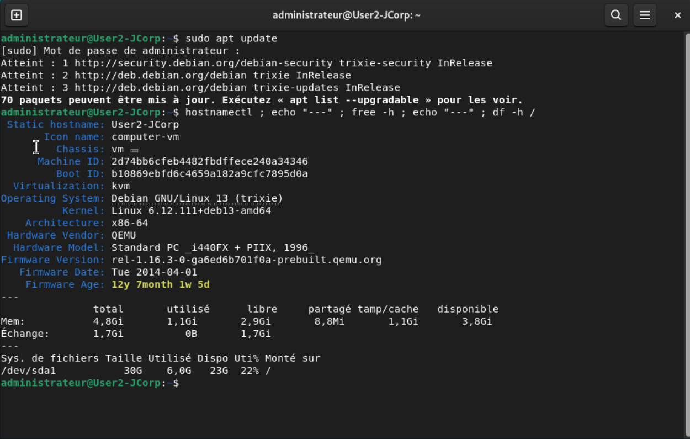
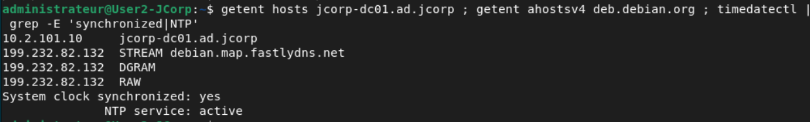
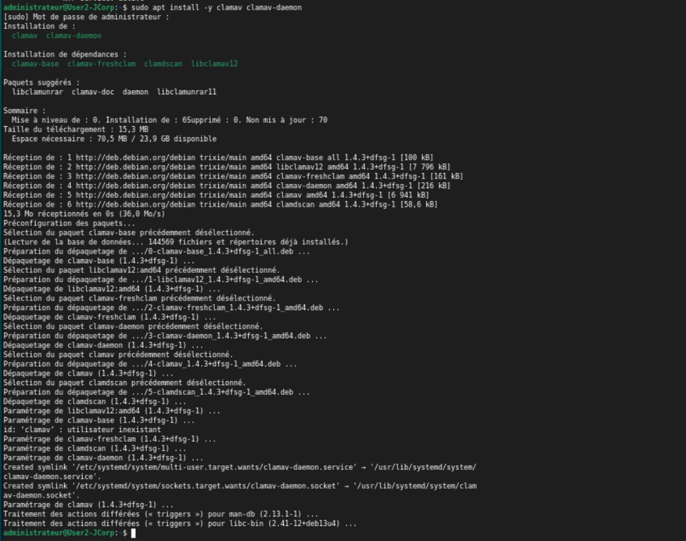

# Rapport de TP — Déploiement de ClamAV et de ClamUI sur un poste Debian

**Auteur :** Joshua Fernandes — SIO 2, option SISR
**Machine :** VM 702, `User2-JCorp-Debian`, Debian 13.3
**Date de réalisation :** _à renseigner_
**Dépôt d'infrastructure associé :** [JCorp-SISR](https://github.com/g0shtj0sh/JCorp-SISR)

---

## Sommaire

1. [Présentation de ClamAV](#1-présentation-de-clamav)
2. [Étape 1 — Installation du moteur et des signatures](#2-étape-1--installation-du-moteur-et-des-signatures)
3. [Étape 2 — Mise en service du démon](#3-étape-2--mise-en-service-du-démon)
4. [Étape 3 — Test de détection avec EICAR](#4-étape-3--test-de-détection-avec-eicar)
5. [Étape 4 — Protection en temps réel et quarantaine](#5-étape-4--protection-en-temps-réel-et-quarantaine)
6. [Étape 5 — Analyse planifiée](#6-étape-5--analyse-planifiée)
7. [Étape 6 — Interface graphique ClamUI](#7-étape-6--interface-graphique-clamui)
8. [Étape 7 — Recette](#8-étape-7--recette)
9. [Limites et conclusion](#9-limites-et-conclusion)

---

## 1. Présentation de ClamAV

ClamAV est un moteur antivirus open source principalement déployé sur les serveurs Linux et les NAS. Il ne cherche pas à deviner si un fichier est malveillant : il compare le contenu des fichiers à une **base de signatures virales**, c'est-à-dire un ensemble d'empreintes de logiciels malveillants connus, mise à jour régulièrement. Son efficacité dépend donc directement de la fraîcheur de cette base.

Il se décompose en plusieurs composants, qu'il faut distinguer pour comprendre la suite du rapport.

| Composant | Rôle |
| --- | --- |
| `clamscan` | Scanner autonome en ligne de commande, embarque son propre moteur |
| `clamd` (`clamav-daemon`) | Démon qui garde la base de signatures chargée en mémoire |
| `clamdscan` | Client léger qui interroge le démon `clamd` |
| `freshclam` | Service de mise à jour des bases de signatures |
| `clamonacc` | Analyse à l'accès (*On-Access*), c'est-à-dire en temps réel |

### Pourquoi deux outils de scan ?

`clamscan` et `clamdscan` font le même travail mais pas de la même façon, et le choix a des conséquences concrètes sur une machine aussi modeste que la VM 702.

| Critère | `clamscan` | `clamdscan` |
| --- | --- | --- |
| Démon requis | Non | Oui |
| Base de signatures | Rechargée à chaque exécution | Déjà chargée en permanence |
| Vitesse de démarrage | Lente, plusieurs secondes | Quasi instantanée |
| Mémoire | Plusieurs centaines de Mio à chaque lancement | Faible côté client, le démon porte la charge |
| Configuration | Options en ligne de commande | Hérite de `clamd.conf` |
| Accès aux fichiers | Lit directement les fichiers | Le démon tourne sous l'utilisateur `clamav`, d'où le besoin fréquent de `--fdpass` |

En clair : `clamscan` convient à une analyse ponctuelle ou planifiée la nuit, `clamdscan` convient à tout ce qui doit répondre vite, et la protection en temps réel impose le démon.

### Contrainte de dimensionnement relevée

Le démon `clamd` conserve l'intégralité de la base de signatures en mémoire, ce qui représente de l'ordre de **1 Gio de RAM**. La VM 702 a été créée avec **2 Gio** pour un usage de poste bureautique sous GNOME. Cette contrainte est traitée à l'étape 2 : elle conditionne le choix entre une installation complète avec temps réel et une installation limitée aux analyses à la demande.


---

## 2. Étape 1 — Installation du moteur et des signatures

### 2.1 Objectif

Installer le moteur ClamAV sur le poste et télécharger une base de signatures à jour, puis s'assurer que la mise à jour automatique est active.

### 2.2 État initial de la machine

Je relève l'état de départ avant toute modification, de façon à pouvoir justifier ensuite mes choix de dimensionnement.

```bash
hostnamectl
free -h
df -h /
```

**Résultat observé :** _à renseigner (version de Debian, noyau, RAM totale et disponible, espace libre sur la racine)._



### 2.3 Contrôle des prérequis réseau

Les bases de signatures pèsent une centaine de mébioctets et sont téléchargées depuis Internet. Un dépôt APT ou un serveur de mise à jour inaccessible ferait échouer les deux étapes suivantes, c'est pourquoi je contrôle la résolution de noms interne et externe ainsi que l'horloge avant de commencer.

```bash
getent hosts jcorp-dc01.ad.jcorp
getent ahostsv4 deb.debian.org
timedatectl
```

**Résultat attendu :** le contrôleur de domaine et un nom externe sont tous deux résolus, l'horloge indique `System clock synchronized: yes` et `NTP service: active`.

**Résultat observé :** _à renseigner._



### 2.4 Installation des paquets

```bash
sudo apt update
sudo apt install -y clamav clamav-daemon
```

Ces deux paquets installent le moteur de détection ainsi que le démon, et entraînent l'installation des dépendances `clamav-base`, `clamav-freshclam`, `clamdscan` et `libclamav12`. Le service de mise à jour `freshclam` est donc présent sans avoir à l'installer explicitement.

Je relève ensuite la version exacte du moteur, qui sera reportée dans la recette :

```bash
clamscan --version
dpkg -l | grep clamav
```

**Résultat observé :** _à renseigner (version du moteur et liste des paquets installés)._



### 2.5 Téléchargement initial des signatures

Après l'installation, la base de signatures est vide : le moteur est en place mais il n'a encore rien à comparer. Une première mise à jour manuelle est donc nécessaire.

Le service `clamav-freshclam` démarre automatiquement à l'installation et maintient un verrou sur le répertoire des bases. Lancer `freshclam` à la main sans l'avoir arrêté provoque une erreur de verrou, d'où l'arrêt préalable du service.

```bash
sudo systemctl stop clamav-freshclam
sudo freshclam
```

La commande télécharge trois bases : `daily.cvd` (environ 23 Mio), `main.cvd` (environ 89 Mio) et `bytecode.cvd`. La sortie indique pour chacune le numéro de version et le nombre de signatures, information utile comme preuve de fraîcheur.

Le service est ensuite remis en route et activé au démarrage, de façon à ce que la base reste à jour sans intervention :

```bash
sudo systemctl enable --now clamav-freshclam
```

**Résultat observé :** _à renseigner (versions des bases et nombre de signatures téléchargées)._


### 2.6 Contrôles de fin d'étape

```bash
ls -alh /var/lib/clamav/
systemctl is-enabled clamav-freshclam
systemctl is-active clamav-freshclam
```

| Contrôle | Résultat attendu | Résultat observé |
| --- | --- | --- |
| Présence des bases | `main.cvd`, `daily.cvd` et `bytecode.cvd` dans `/var/lib/clamav/`, propriétaire `clamav` | _à renseigner_ |
| Démarrage automatique de la mise à jour | `enabled` | _à renseigner_ |
| Service de mise à jour en fonctionnement | `active` | _à renseigner_ |


---

## 3. Étape 2 — Mise en service du démon

### 3.1 Objectif

Activer `clamav-daemon` et contrôler son état, après avoir traité la contrainte de mémoire identifiée au chapitre 1.

### 3.2 Décision de dimensionnement

_Section à compléter : indiquer si la mémoire de la VM a été augmentée, la valeur retenue et la justification. Si la mémoire reste à 2 Gio, documenter le choix de ne pas activer le démon et les conséquences sur les étapes 4 et 7._

### 3.3 Activation et contrôle

_À compléter à l'étape suivante du TP._

---

## 4. Étape 3 — Test de détection avec EICAR

### 4.1 Qu'est-ce que le fichier EICAR ?

Le fichier EICAR, du nom de l'*European Institute for Computer Antivirus Research*, est un **faux virus de test**. C'est un simple fichier texte qui ne contient aucun code malveillant, mais dont la chaîne de caractères est reconnue comme virus de test par la quasi-totalité des antivirus, ClamAV compris. Il permet donc de vérifier qu'une chaîne de détection complète fonctionne — scan, journalisation, alerte, quarantaine — sans jamais manipuler un véritable logiciel malveillant.

C'est la bonne pratique : on ne teste jamais un antivirus avec un vrai échantillon sur une machine de production ou de laboratoire reliée au réseau de l'entreprise.

> **Remarque sur ce dépôt :** la chaîne EICAR n'est volontairement pas recopiée telle quelle dans ce rapport, et le fichier `eicar.txt` est exclu par le `.gitignore`. Un dépôt contenant la signature complète serait signalé comme infecté par l'antivirus de tout poste qui le clone. Les commandes du TP reconstituent la chaîne par concaténation, ce qui produit exactement le même fichier au moment de l'exécution.

_Section à compléter à l'étape suivante du TP._

---

## 5. Étape 4 — Protection en temps réel et quarantaine

_Section à compléter._

---

## 6. Étape 5 — Analyse planifiée

_Section à compléter._

---

## 7. Étape 6 — Interface graphique ClamUI

### 7.1 Ce qu'est ClamUI

ClamAV ne dispose pas d'interface graphique officielle. ClamUI est un projet open source construit avec GTK et libadwaita, qui s'intègre nativement à un bureau GNOME comme celui de la VM 702. Il ne s'agit **pas** d'un second moteur antivirus : ClamUI est une surcouche qui appelle `clamscan`, `clamdscan`, `freshclam` et `clamonacc` à la place de l'utilisateur et présente les résultats dans une interface lisible, avec en plus un tableau de bord d'audit de sécurité du système.

Son intérêt dans le contexte JCorp est précisément celui d'un poste de travail : un utilisateur comme Joshua Fernandes doit pouvoir analyser une clé USB ou un téléchargement sans ouvrir de terminal.

### 7.2 Version retenue et écart avec le tutoriel

Le tutoriel suivi décrit la version **0.2.0** et signale deux difficultés : un défaut d'élévation de privilèges sur la distribution Flatpak, et un paquet `.deb` qui refuse de s'installer sur Debian 13 parce que sa dépendance `policykit-1` n'existe plus dans cette version de la distribution.

Je retiens donc la version **0.6.0**, publiée le 11 novembre 2026, qui règle ce point en séparant l'application et son composant privilégié en deux paquets distincts :

| Paquet | Rôle |
| --- | --- |
| `clamui_0.6.0_amd64.deb` | Application de bureau |
| `clamui-privileged-helper_0.6.0_amd64.deb` | Composant privilégié, nécessaire aux opérations demandant une élévation (configuration du temps réel, écriture de `clamd.conf`) |

L'installation par Flatpak est écartée pour cette raison. Cet écart avec le tutoriel est assumé et documenté : reprendre la version du tutoriel aurait conduit à un échec d'installation sur Debian 13.

_Section à compléter._

---

## 8. Étape 7 — Recette

Tableau de validation à compléter au fur et à mesure. Un contrôle n'est déclaré conforme que si sa preuve est enregistrée.

| N° | Contrôle | Résultat attendu | Résultat | Preuve |
| --- | --- | --- | --- | --- |
| 1 | Moteur installé | Version de `clamscan` affichée | _à renseigner_ | `etape1-installation-paquets.png` |
| 2 | Signatures présentes | Trois bases `.cvd` dans `/var/lib/clamav/` | _à renseigner_ | `etape1-freshclam.png` |
| 3 | Mise à jour automatique | `clamav-freshclam` `enabled` et `active` | _à renseigner_ | `etape1-controles.png` |
| 4 | Démon opérationnel | `clamav-daemon` `active (running)` | _à renseigner_ | _à produire_ |
| 5 | Détection à la demande | EICAR détecté par `clamscan` | _à renseigner_ | _à produire_ |
| 6 | Détection en temps réel | EICAR détecté et déplacé en quarantaine dès son écriture | _à renseigner_ | _à produire_ |
| 7 | Journalisation | Détection tracée dans le journal correspondant | _à renseigner_ | _à produire_ |
| 8 | Analyse planifiée | *Timer* actif et prochaine exécution affichée | _à renseigner_ | _à produire_ |
| 9 | Interface graphique | ClamUI lancé, état du moteur et des signatures affiché | _à renseigner_ | _à produire_ |
| 10 | Scan depuis l'interface | Analyse déclenchée et résultat affiché dans ClamUI | _à renseigner_ | _à produire_ |

---

## 9. Limites et conclusion

_Section à rédiger en fin de TP. Points à traiter :_

- ClamAV repose principalement sur des signatures : il est efficace sur les menaces connues, mais nettement moins sur les attaques du jour et les variantes fortement obfusquées. Ce n'est pas un EDR.
- L'outil est conçu avant tout pour des serveurs Linux ; sur un poste de travail il apporte une protection utile mais partielle.
- Le coût en CPU, en mémoire et en temps d'analyse est réel, ce qu'illustre concrètement la contrainte de mémoire rencontrée sur la VM 702.
- ClamAV doit être considéré comme une brique parmi d'autres, aux côtés du filtrage en amont, du durcissement du système, du contrôle des accès et de la sensibilisation des utilisateurs.
- Prolongement possible dans le projet JCorp : remonter l'état de l'antivirus et les détections vers la supervision Grafana/Prometheus prévue en atelier professionnel 1, afin de ne plus dépendre d'un contrôle poste par poste.

---

[Retour à la présentation du TP](README.md)
